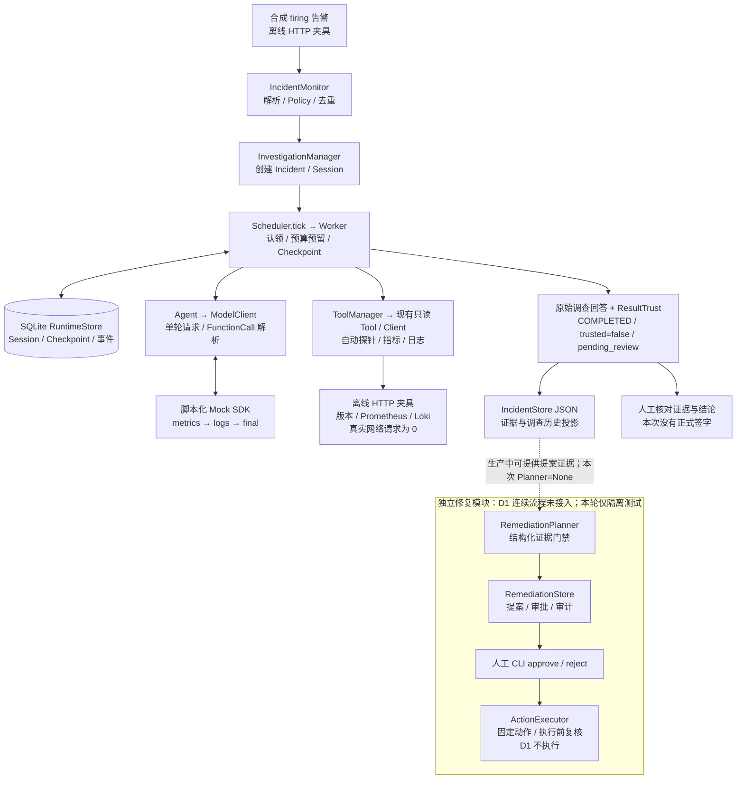

# Incident Agent D1：离线运行与展示教程

这个 Demo 演示：合成告警 → 创建 Incident / Session → 多轮调查及只读工具 → SQLite / Checkpoint → 证据约束结论 → 等待人工审阅。

**模型响应与 HTTP 响应均为 Mock；Monitor、Agent、Worker、ToolManager、预算校验和 SQLite 使用现有实现并实际执行。** 不需要密钥、Docker、Prometheus、Loki 或业务服务。它验证工程流程，不验证真实模型的调查能力，也不确认根因或业务恢复。

## 1. 一条命令运行

本机已验证 Python 3.12.14、Pydantic 2.13.5、OpenAI SDK 3.14.0。PowerShell：

```powershell
Set-Location 'D:\Incident Agent'
& 'D:\conda\envs\agentlearn\python.exe' -B scripts\d1_demo.py
```

退出码为 0 表示演示执行及持久化核对完成。默认生成新的 `data/d1-demo-<UTC时间>-<随机ID>/`，最后打印绝对路径。无需填写或加载 `.env`。其他机器需要先按仓库的 `requirements.lock.txt` 准备 Python 3.12 依赖；本轮没有执行依赖安装。

希望固定目录时，使用一个**尚不存在**的目录：

```powershell
& 'D:\conda\envs\agentlearn\python.exe' -B scripts\d1_demo.py --output-dir data\d1-interview-01
```

重复使用目录会返回退出码 2，并拒绝覆盖。省略该参数即可生成另一份新演示。

可选的无数据场景：

```powershell
& 'D:\conda\envs\agentlearn\python.exe' -B scripts\d1_demo.py --scenario no_data
```

该场景仍可完成调查流程，但 `query_metrics` 返回 `no_data` 且没有 `value`。不能把它讲成错误率为零或服务健康。

原有入口也可独立运行；D1 只是增加可读展示和只读核验：

```powershell
& 'D:\conda\envs\agentlearn\python.exe' -B scripts\p64_offline_investigation.py --scenario multi_round --output-dir data\d1-original-entry-01
```

离线入口临时使用进程级 Mock 和传输阻断，应作为独立命令运行，不将 `run_demo()` 嵌入正在运行的生产进程。

本轮演示使用离线入口。根目录 `main.py` 是生产装配入口，会连接外部系统，不属于本教程的运行步骤。

## 2. 终端中依次看什么

| 步骤 | 展示与讲解重点 |
| --- | --- |
| 1. 告警 | 合成 `HighHttp5xxRate`，`order-service`、0.27、阈值 0.2。重复观察由 Monitor 去重 |
| 2. 调查任务 | 实际生成 Incident ID / Session ID，状态最终为 `COMPLETED` |
| 3. 工具选择 | 第 1 轮 Mock 选择 `query_metrics`，第 2 轮选择 `query_logs`，第 3 轮给出固定回答；生产 Agent 负责解析，不声称本次有真实模型自主选择 |
| 4. 证据 | 展示完整工具参数、结果、call_id、observation_id、采集时间与 HTTP 夹具来源。Worker 的自动版本探针也计入预算，因此共 3 次工具执行 |
| 5. 持久化 | 只读重开本次 SQLite，逐项核对 Session / Checkpoint，检查数据库及原件哈希 |
| 6. 结论 | 原始 Mock 回答逐字保留，明确没有确认根因或恢复 |
| 7. 人工审阅 | 展示 `trusted=false / pending_review`，由人继续检查来源和结论 |

终端是**执行完成后按持久化记录生成的导览**，不是实时逐行直播。完整输出见[实际示例输出](D1_DEMO_OUTPUT_2026-10-22_16-44-32.md)；面试顺序见[讲解提纲](D1_INTERVIEW_OUTLINE_2026-10-22_16-44-32.md)。

0.27、`aaaaaaaa…` 版本和日志均为合成夹具。虽然日志中存在时间戳，它仍不是现场证据。告警没有 `starts_at`，日志使用最近窗口，不能声称完成了告警窗口对齐。未收集源码与故障路径证据，不能确认代码根因。

## 3. 输出文件与复查

| 路径（相对于本次输出目录） | 内容 |
| --- | --- |
| `demo-transcript.txt` | UTF-8 可读输出，与终端展示一致 |
| `demo-summary.json` | 运行方式、计数、SQLite 核对、ResultTrust 和零外部请求记录 |
| `runtime-stdout.txt` | 原有 Runtime 通知输出，没有替换其原文 |
| `report.json`、`runtime/report.json` | 既有 P6.4 / P6.1 的完整结构化报告、模型夹具、工具记录和 HTTP 夹具 |
| `runtime/stores/runtime.sqlite3` | 本次新建的权威 Session / Checkpoint / 事件记录 |
| `runtime/stores/incidents.json` | Incident、证据及调查历史的 JSON 投影 |
| `worker_boundaries.json` | 模型/工具操作边界上已提交的 Checkpoint 快照 |
| `sha256.json`、`demo-sha256.json` | 原入口和 D1 的文件一致性清单；清单不包含自身 |

将终端打印的目录填入变量即可离线复查：

```powershell
$demoDir = 'D:\Incident Agent\data\替换为本次输出目录'
Get-Content -LiteralPath "$demoDir\demo-summary.json" -Raw -Encoding UTF8
Get-Content -LiteralPath "$demoDir\demo-transcript.txt" -Encoding UTF8
```

运行数据按原有规则被 Git 忽略。新机器可重新运行 Mock Demo；历史真实模型实验的本地封存原件不会随普通克隆自动获取。文件哈希只能说明本地内容一致，不能证明夹具是真实观测或回答语义正确。

## 4. 系统架构与本次边界



SQLite 管调查状态，Incident JSON 管投影，Remediation JSON 管修复审批；三者没有共同事务。不要把这张图理解成跨存储原子提交。Worker 边界快照用于核对各轮已保存记录；本次仍使用原有证据重建上下文策略，不能由此认定任意 Provider 的完整 Responses 链都已兼容。

## 5. 人工审阅与修复审批分别怎样展示

`mechanical_status=passed / mechanical_scope=result_schema_only` 只说明结果模型结构合法。`pending_review` 表示语义尚待审查；`trusted=false` 不是“运行失败”。`human_approval=not_recorded` 表示没有最终结论的正式批准记录，也不能拿实验执行授权代替它。

本连续流程停在人工阅读证据和原答。人需要核对工具来源、时间范围、`no_data`、事实/假设/缺口，再决定后续调查。**现有 ResultTrust 没有正式人工接受的写入口**，因此阅读完成也不会自动变成 `accepted`；本轮不新增该接口。

修复审批是另一条已有业务链：确定性 Planner 产生满足条件的 `pending` 提案 → 人工 CLI `approve` 或 `reject` → 独立执行器再次校验。本 Demo 的 Planner 为 None，没有生成提案，也没有 HumanRequest。不能声称人工回复、审阅结论或 Session 完成已批准修复。

为了单独展示现有审批模块，本轮最小回归中执行了以下既有测试：

```powershell
& 'D:\conda\envs\agentlearn\python.exe' -B -m pytest -p no:cacheprovider tests\test_remediation.py::StoreTests::test_approve_roundtrip_audit tests\test_remediation.py::StoreTests::test_reject_roundtrip_audit tests\test_remediation.py::ExecutorTests::test_cli_approve_has_no_action -v
```

它们在临时 Store 和 Mock runtime 中验证批准/拒绝的持久化审计及 CLI 批准不执行动作；测试中的操作者字符串只是夹具，不是真人签字。它们属于**独立模块测试**，没有接到 D1 Incident 上。

实际人工审批命令的接口形式是 `remediation_cli.py --store <提案文件> approve <proposal_id> --by <操作者>`，拒绝还需 `reject ... --reason <原因>`。本轮没有运行这些命令处理实际提案，也不提供执行真实修复的演示步骤。

## 6. 历史模型证据怎样讲

[第三次真实实验报告](P6_5_THIRD_REAL_INVESTIGATION_2026-10-22_10-44-31.md)记录了 2026-10-22 的 2 次真实 SDK 请求，第二轮携带 4 组工具输出，最终 Session 完成。实际请求模型名称为 `deepseek-flash`；这里的 **v3 是实验请求协议 `p65_dynamic_runtime_v3_tools5`，不能据此称模型就是 DeepSeek V3**。

该历史实验使用封存证据，5 次本地历史工具执行含自动探针。日志范围未命中、部分指标无数据，最终仍为 `trusted=false / pending_review`。本轮只读核对了原答哈希、summary 和请求中的模型/输出数量，没有重新调用模型，也没有重新认证整个历史封印链。语义问题可查[既有离线修复报告](P6_5_S1_OFFLINE_REPAIR_2026-10-22_12-00-22.md)。

[v5 精简引用报告](P6_5_S3_COMPACT_REFERENCE_VALIDATION_2026-10-22_15-56-38.md)仅证明离线兼容验证通过。没有新的真实 Provider 遵循率、精确 token 容量或根因准确率验证。历史证据与本次 Mock 演示应分开介绍。

## 7. 常见问题

- `field_validator` 导入失败：通常选到了 Pydantic 1 环境，改用上面的 `agentlearn` 解释器。
- 演示目录已存在：省略 `--output-dir` 或换新目录；不要删除历史数据来重跑。
- 不明白为什么是 3 次工具：自动版本探针 1 次，加 Mock 指定的指标和日志各 1 次。
- 看到 `COMPLETED`，Incident 仍未恢复：两者语义独立；本次没有验证业务恢复。
- 没有前端页面：本轮交付是可复现终端演示；原有 Web 工作台不是此次必需入口，没有启动或复测。
