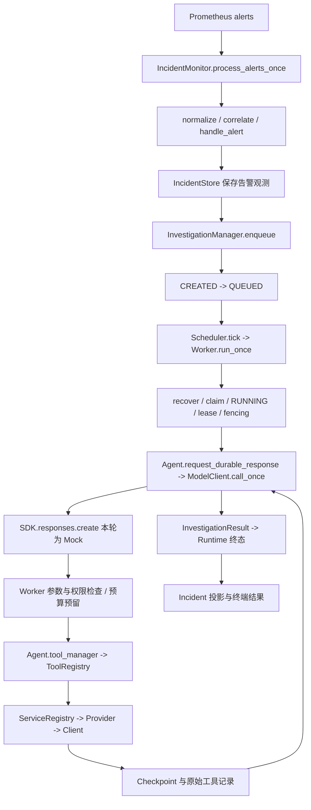

# P6.1 真实服务只读调查联调验证报告

## 1. 结论与证据等级

本轮已实际完成 10 个离线端到端调查场景、14 次真实测试环境只读 HTTP GET，以及一次真实观测原件的隔离回放。模型决策使用脚本化 Mock SDK；真实 DeepSeek/OpenAI 模型请求为 0。没有访问业务路由、直连 PostgreSQL、注入故障、修改开关、执行修复、启动或停止服务。

| 验证对象 | 本轮结论 |
| --- | --- |
| 真实服务观测 | order-service 元数据路由、Prometheus、Loki 可访问；数据库仅经 exporter/Prometheus 间接观测 |
| Mock 调查流程 | Monitor 到 Runtime、工具证据、InvestigationResult 和持久化的完整路径已实跑 |
| 真实模型调查 | 未执行，Mock 的解释质量不能证明真实模型能力 |
| 真实故障注入 | 未执行；来源不可用等失败路径采用离线夹具 |
| 实际业务恢复 | 未验证，业务状态仍为 unknown |
| P6.2 准入 | 可供人工评审；取决于 P6.2 的明确目标及下述证据缺口，不能视为自动获准 |

本报告中的测试数字与环境结论来自本轮输出，不沿用旧报告结论。全部原始本地产物在 [本轮产物目录](../data/p61-current-20261018-e8f7/)，该目录受既有 Git 忽略规则保护，不随代码提交。

## 2. 基线、已有 diff 与修改范围

- Incident Agent：`main`，开始时 HEAD 为 `4477dc0dfdd196e431392656cfb358f2a78654dc`。真实 `git ls-remote origin HEAD refs/heads/main` 返回同一 SHA，见 [远端查询原件](../data/p61-current-20261018-e8f7/remote-main.log)。
- 最新提交只新增 P5 辅助约束入口、两份 P5 测试和 P5 报告，没有提交 P6.1 文件。此前对话已留下未跟踪的 `p61_readonly_integration.py` 和对应测试，本轮复用并完善，不创建第二套引擎。
- Demo：`codex/postgres-monitoring`，HEAD 为 `0e2f6f3220b9fb9f0baf8730de5ffaaac00d8c38`。既有 README 修改把示例 `/order` 改成 `/error`，未改动。
- 已读根目录 `AGENTS.md`。Demo 根目录及子目录没有实际 `AGENTS.md`，`D:\AGENTS.md` 也不存在；没有假设存在额外指令。
- 原有 README、prompt、temp_test、历史文档归档和其他未跟踪报告保留，不纳入 P6.1 提交。没有执行 reset、clean、stash 或全局格式化。

| 本轮交付文件 | 用途 |
| --- | --- |
| [离线集成入口](../scripts/p61_readonly_integration.py) | 复用既有真实应用层，隔离存储、Mock SDK/HTTP、失败路径及原件回放 |
| [离线集成测试](../tests/test_p61_readonly_integration.py) | 端到端流程、权限、预算、证据、日志隔离和回放反例 |
| [只读采集入口](../scripts/p61_collect_observations.py) | 显式运行、受限 GET、真实工具解析、原始 HTTP 和来源链 |
| [采集器测试](../tests/test_p61_collect_observations.py) | 仅 Mock HTTP，验证白名单、大小限制、错误、哈希、拒绝覆盖和导入安全 |
| 本报告 | 本轮观测、运行记录、人工审查稿及阶段条件 |

未修改生产模块、配置、预算、状态机、数据库 schema 或修复策略；没有新增依赖。入口只新增测试用途的 `run_case(...)`、`run_collection(...)` 和显式 CLI，不改变应用公开接口。P5.3c.2g 辅助约束继续独立，未接入生产 Runtime。

修复了既有 P6.1 入口的局部日志隔离缺口：仅替换 `agent` 自身 handler 仍可能传播到 root FileHandler。本轮临时设置 `propagate=False`，退出后恢复；回归验证现有 root 日志内容和 handler 不变。

## 3. 根据当前代码核实的调用链



已追踪 [main.py](../main.py)、[Monitor](../monitor/incident_monitor.py)、[Manager](../investigation/manager.py)、[Worker](../investigation/worker.py)、[Scheduler](../investigation/scheduler.py)、[RuntimeStore](../investigation/store.py)、[Agent](../agent/agent.py)、[ModelClient](../model_client/model_client.py)、[工具注册](../tools/tool_registry.py)、metrics/logs/health 工具、[服务配置](../services/configuration.py)、[Registry](../services/registry.py) 和 Prometheus/Loki 客户端。

生产 `main()` 会装配真实 SDK、RemediationPlanner、Scheduler 与 RecoveryWorker。本轮没有调用它；仅同步调用一次 `Scheduler.tick()`，未启动后台线程。Runtime SQLite 是 Session、Checkpoint、预算和事件的权威存储；Incident JSON 是告警与调查证据投影。两种存储不是跨文件原子事务，不把重开一致性验证扩大解释为跨存储事务保证。

## 4. 测试环境归属与实际连通情况

已在采集前核对进程及容器归属，之后再次保存 [归属核对原件](../data/p61-current-20261018-e8f7/ownership.json)。PID 29476 命令行为 `D:\conda\envs\agentlearn\python.exe -u d:\prometheus-demo\app.py`。数据库和 exporter 的 Compose 标签指向 Demo；Prometheus、Loki、Alloy 的只读配置或日志挂载均指向 Demo。未读取容器环境变量或密钥内容。

正式采集时间：`2026-10-18T05:55:16.005836+00:00` 至 `05:55:24.609006+00:00`，即北京时间 13:55:16 至 13:55:24。下表仅表示该时段的观测。

| 对象 | 实际来源与请求 ID | 本轮结果 | 不能证明的内容 |
| --- | --- | --- | --- |
| order-service | `8001/metrics` 001、`/health` 007、`/version` 008 | 均 HTTP 200，health=ok；运行 flags 两项 false；commit_sha=null，工具返回 no_data/commit_unknown | 不证明业务正常、数据库业务访问成功或运行代码等于 Git HEAD |
| Prometheus | `9090/-/ready` 002、alerts 003、query 005/009-012、targets 013/014 | 均 HTTP 200；order-service 与 postgres 目标 up，last_error 为空 | 不证明所有业务指标都有数据或查询具有原子性 |
| Loki | `3100/ready` 004、query_range 006 | HTTP 200；最近一小时查询为空，no_data/no_logs_in_query_range | 不证明现实没有日志，也不证明本轮日志写入链路成功 |
| PostgreSQL | Prometheus postgres_up 011、exporter_scrape_up 012、target 014 | 两项值均 1.0，目标 up；这是 exporter/Prometheus 间接观测 | 未直连 DB，未验证 order-service 的业务查询与实际业务恢复 |

Prometheus target 原件中 order-service 的 last_scrape 为 `05:55:20.674407606Z`，postgres 为 `05:55:24.212797743Z`。本轮各指标评估时间也不同；相同评估时间本身也不能证明相同抓取时间。

Demo 启动入口为 `app.py`；已有 `start_demo.ps1` 支持启动时版本与故障 flags。`/health` 不查 DB，`/metrics` 使用 `generate_latest()`；`/order` 虽然只执行 SELECT，但会产生业务日志、指标和依赖 Gauge，并可能进入已有故障分支，因此本轮没有访问。

Prometheus 按 Demo `prometheus.yml` 每 5 秒抓取 8001/9187。Alloy 配置从 Demo 日志文件推送 Loki；配置与挂载存在只证明配置链路，空 recent 结果不足以证明实际摄取成功。现有故障开关和故障注入入口均未执行。

环境不是未启动状态，无需提供或执行新启动操作。已有启动方式为 Demo 的 `start_demo.ps1` 和数据库 Compose；本轮既未调用，也未重启任何组件。现有 8001/9090/3100/Alloy 管理端口存在非回环绑定，这是既有隔离环境的暴露范围限制；未修改绑定或断言公网可达。

## 5. 真实只读证据与缺失信息

[采集摘要](../data/p61-current-20261018-e8f7/real-observations/collection_report.json)、[主工具观测](../data/p61-current-20261018-e8f7/real-observations/observations.json)、[补充观测](../data/p61-current-20261018-e8f7/real-observations/supplemental_observations.json) 和同目录逐请求 `.json/.body` 保留原件。

- `http_5xx_rate` 返回空 vector，工具为 no_data，没有 `value`；不是 0 或正常错误率。
- `http_request_rate` 同样 no_data。`/metrics` 原件只有业务 metric 的 HELP/TYPE，没有相应带标签样本；这是本轮可确认的缺失，不能补成历史值。缺少近期业务流量是可能解释，但没有请求业务路由验证。
- `service_scrape_up=1.0`、`postgres_up=1.0`、`exporter_scrape_up=1.0` 是各次查询的实际值，不等价于业务健康。
- 日志范围为 `[2026-10-18T04:55:20.062896200Z, 2026-10-18T05:55:20.062896200Z)`，`mode=recent`、`evidence_scope=recent`，不是告警窗口。没有虚构 order-service 告警起止时间。
- alerts 原件只有 inventory-service 的 ServiceDown，未观察到 order-service firing。没有对 inventory-service 发探测或创建真实调查；离线/回放用的 HighHttp5xxRate=0.27 是明确的合成输入。
- 逐请求保存 URL、参数、UTC 起止时间、HTTP 状态、错误类型、完成标识、原始字节及 SHA-256；工具记录通过 `request_ids` 对应原件。`request_executed` 只表示本地 HTTP 客户端进入调用，不单独证明服务器收到请求。
- 14 次正式请求均 HTTP 200 且正文完整。更早的探索探测曾见 Loki ready=503，但未保存完整正文与逐请求精确时间，不作为本表的正式观测，不能据此推断可用性变化原因。

## 6. 一次完整离线调查运行记录

运行目录：[offline_ok](../data/p61-current-20261018-e8f7/offline/offline_ok/)，开始 `05:55:44.947840Z`，完成 `05:55:55.890230Z`。

```text
Incident: inc-c761e5de
Session: ses-a5521b8a4d29411e99070f705b4842bb
Checkpoint: cp-a2ee285bc6e5413496078aa68e825cfc
合成告警: order-service / HighHttp5xxRate / 0.27 / starts_at=None
CREATED -> QUEUED -> RUNNING -> COMPLETED
Mock 决策轮数: 2
工具执行: 4（自动 version + metrics + logs + health）
真实模型请求: 0；真实服务观测: 0
Incident: investigating；alert_state=firing；recovery_verified_at=None
```

同一合成告警提交两次只匹配一个 Incident/Session。39 条保存事件覆盖创建、排队、重复调查拒绝、Worker claim、预算预留、响应/工具/Checkpoint 保存、完成和输出通知。4 条工具记录具有 observation_id，成功的证据投影逐条与原结果比对；只读重开 SQLite 后 Session 和 Checkpoint 相同，function_call/output 链校验通过。

事件与完整 Mock 请求/响应、参数、证据、InvestigationResult 均在 [report.json](../data/p61-current-20261018-e8f7/offline/offline_ok/report.json)。[sha256.json](../data/p61-current-20261018-e8f7/offline/offline_ok/sha256.json) 绑定 report、Runtime SQLite、Incident JSON；哈希提供本地完整性校验，不构成外部来源签名。

## 7. 失败路径、预算与权限

以下都是本轮逐个独立进程运行的离线场景。每个目录保存 report、日志及隔离 stores；来源失败未通过停真实服务模拟。

| 场景 | Session 状态 | Mock 轮数 / 工具次数 | 实际检查结果 |
| --- | --- | --- | --- |
| offline_ok | COMPLETED | 2 / 4 | 有效指标、日志、健康与版本保存，重复告警匹配 |
| metric_zero | COMPLETED | 2 / 4 | 有限 0.0 为有效值 |
| metrics_no_data | COMPLETED | 2 / 4 | no_data 无 value，Checkpoint 保留缺失状态 |
| prometheus_unavailable | COMPLETED | 2 / 4 | 指标 no_data，日志仍可用 |
| loki_unavailable | COMPLETED | 2 / 4 | 日志 no_data，指标仍可用 |
| permissions | COMPLETED | 2 / 4 | 修复工具与 inventory-service 目标在 dispatch 前被拒，2 条 tool_rejected |
| tool_budget | COMPLETED | 2 / 13 | 自动 version 占 1 次，12 次指标执行，额外 2 次被拒；末轮工具 schema 为空 |
| model_budget | EXHAUSTED | 7 / 1 | 无第 8 次 Mock 请求，结果 success=false |
| model_failure | FAILED | 2 / 4 | 模拟解释 ValueError，已收证据保留，未标为恢复 |
| model_incomplete | WAITING_RETRY | 2 / 4 | 不完整响应不记成功；本轮不启动重试调度或额外请求 |

所有场景保持 `alert_state=firing`，没有 recovery_verified_at。`COMPLETED` 仅表示脚本化调查完成，不是业务恢复。Health=ok 也不解除合成告警。

预算仍由原 Worker 在 dispatch 前事务性预留：每 attempt 最多 7 轮模型/13 次工具；生命周期最多 3 attempts、21 模型请求、39 工具执行。持久化 reservation 事件数量与计数一致，Mock SDK 入口同时断言 RUNNING、有效 lease 和已预留计数。未直接编辑数据库状态或修改预算配置。

离线入口在应用导入前阻断 socket、真实 SDK 构造、requests transport、psycopg、子进程和线程；只替换已列明的 HTTP 夹具入口。remediation executor 与 RecoveryWorker 启动也被阻断，manager 未设置 planner。实际 `forbidden_io_attempts=[]`。采集器只允许 localhost 固定端口/路径 GET，禁环境代理、认证、跳转、业务路由、压缩和超大响应，并有连接/读取超时及总期限检查；不是精确 8 秒的进程级硬截止。

## 8. 真实观测回放与待人工审查的调查稿

[回放记录](../data/p61-current-20261018-e8f7/captured-replay/report.json)：`ses-88d6d8fb512e4bd6ad53fe114b57f794`，`06:03:00.405552Z` 至 `06:03:09.093991Z`，COMPLETED，2 轮 Mock 决策、4 次受控工具执行。没有再次访问服务，没有将缺项补成 Mock 数据。

回放以真实工具原件替换受控工具输出，仍经过真实 Worker 权限、预算与 Checkpoint。为防止历史 health/version 被重新续期，外层明确 `no_data/time_window/use_for_current_state=False`，分别保存 `captured_at`、`captured_result` 和回放时间。因此 Runtime 的回放 collected_at 不是实际采集时间，不能声称“真实 Provider 在该次 Runtime 中再次执行”。正式采集原件和回放记录必须一并保留。

待人工审查稿（开发验证整理，不是经验证的模型根因判断）：

> 观测时段内 order-service 元数据路由可访问，Prometheus 抓取目标为 up，exporter 间接报告 PostgreSQL up。错误率与业务请求率没有有效结果，recent 日志查询为空，运行 commit 未知。当前证据只能确认上述观测，不能确认根因、业务健康、告警恢复或代码因果。离线合成告警用于验证调查流程，不代表真实 order-service 故障。尚未执行真实模型、故障注入或修复，业务状态为 unknown。建议人工先审查证据来源及缺失条件，再定义下一阶段验证目标。

Mock 原始回答保留在 report 的 `investigation_report` 和 Checkpoint，未将其解释提升为可信事实。人工审查状态为待审查。

## 9. 本轮测试与复现

统一解释器 `D:\conda\envs\agentlearn\python.exe`，Python 3.12.14；所有运行均带 `-B`。没有导入或运行 `temp_test.py` 的真实日志查询入口。

| 检查 | 本轮结果 | 原件 |
| --- | --- | --- |
| P6.1 离线测试 + 现有 test_incident_mock_e2e | 48 passed，94.03 秒 | [targeted.xml](../data/p61-current-20261018-e8f7/targeted.xml) |
| 采集器最终定向测试 | 18 passed，1.52 秒；仅 Mock HTTP | [collector.xml](../data/p61-current-20261018-e8f7/collector.xml) |
| 首轮全量 Python 回归 | 1959 passed、2 skipped、190 subtests passed，844.91 秒 | [full.xml](../data/p61-current-20261018-e8f7/full.xml) |
| 最终冻结版本全量回归 | 1960 passed、2 skipped、190 subtests passed，741.75 秒 | [full-final.xml](../data/p61-current-20261018-e8f7/full-final.xml) |
| Demo alerts.yml 跨仓库契约 | 1 passed，1.85 秒 | [rules.xml](../data/p61-current-20261018-e8f7/rules.xml) |
| pip check | No broken requirements found | [pip-check.log](../data/p61-current-20261018-e8f7/pip-check.log) |

首轮全量收集了采集器 17 项测试；其后补了 provider/request 元数据和导入安全测试，所以单独验证 18 项后，对冻结版本重新全量回归。两项默认 skip 原因为：干净安装检查只在 CI/隔离 venv 执行；跨仓库规则未默认配置 ALERT_RULES_PATH。后者本轮另外显式指定实际 Demo alerts.yml 执行，结果见上表；没有把 skip 写成通过。

前两次定向尝试失败也保留事实：首次系统 pytest 目录权限导致 47 个 setup error、1 passed，未进入相应业务测试；第二次误把 basetemp 放在 data/ 下，被既有 conftest 存储保护拒绝，47 failed、1 passed。随后使用提权进程和独立系统临时目录通过，没有弱化保护。失败目录与产物均未删除。

可复现入口（所有输出目录必须全新，已存在即失败）：

```powershell
& 'D:\conda\envs\agentlearn\python.exe' -B scripts/p61_readonly_integration.py --scenario offline_ok --output-dir '<全新离线目录>'
& 'D:\conda\envs\agentlearn\python.exe' -B scripts/p61_collect_observations.py --output-dir '<全新采集目录>'
& 'D:\conda\envs\agentlearn\python.exe' -B scripts/p61_readonly_integration.py --observations '<采集目录>\observations.json' --output-dir '<全新回放目录>'
& 'D:\conda\envs\agentlearn\python.exe' -B -m pytest -q -p no:cacheprovider --basetemp '<独立可写系统临时目录>'
& 'D:\conda\envs\agentlearn\python.exe' -B -m pip check
```

采集命令只可在重新确认本机服务归属后显式执行；命令示例不是启动服务或故障授权。测试 basetemp 不得设在生产 data/ 树内。

## 10. 原有文件、完整性与交付边界

基线记录 1085 个文件，见 [基线清单](../data/p61_baseline_20261018_1320.json)。[保留核对结果](../data/p61-current-20261018-e8f7/preservation-audit.json)：1082 个已有可比较文件 SHA-256 不变，2 个既有 P6.1 文件为授权修改，没有缺失或意外变化；1 个 Demo app.log 在基线中 SHA 为 null，无法证明其内容不变。其长度当时和复核时均为 900127；不把长度相同等同于内容相同。

最终回归结束后再次核对，结果仍为上述 1082 / 2 / 1，没有意外变化；10 个离线目录、1 个回放目录和真实采集目录的 12 份哈希清单共校验 64 个文件，0 个不匹配。[最终核对原件](../data/p61-current-20261018-e8f7/final-verification.json) 同时保存四份交付代码/测试的 SHA-256 和各轮 JUnit 状态。全量 JUnit 的 2152 条记录包含 190 个子测试，不与 pytest 的 1960 passed 重复累加。

关键既有文件：

| 文件 | 保持的 SHA-256 |
| --- | --- |
| data/runtime.sqlite3 | 7A956E75D9EA98C44D2819EEB1276D1AA3E843E9822F4C0DA93FA53523E82D14 |
| data/incidents.json | D0E6B29F6A66D8E5835BF1C790A801AE67570B580907343958152C50552EBA78 |
| agent_logger/agent.log | B430915BF4625D514EFC3AD2EAB351A1D24F959BFF53FA5DED8D91CDDB5BFE81 |

旧 P6.1 目录 `data/p61-20261018T032456Z-41e121dd/` 的 109 个文件也保持原哈希。提交前暂存区为空，原 index 哈希为 `7EB0D643540F06DF227CB5FFEFB0224453FDE47E2BF08CF9B3F5BD800B51743F`；后续选择性暂存当然会改变 index，不将该变化误报为用户数据变化。

本轮运行只写新产物目录和独立测试临时目录；没有 HTTP 写请求、GitHub 工具写入、数据库业务写入或未经授权的修复。只读探测可能产生服务自身的访问遥测；不将这一点与业务数据写入混淆。报告与代码提交不包含本地运行数据、原始服务日志、密钥或环境文件。

## 11. 已确认问题、阻断项与非阻断技术债

| 类型 | 项目 | 对后续阶段的影响 |
| --- | --- | --- |
| 已修复局部问题 | P6.1 日志向 root handler 传播 | 已补隔离与恢复测试，不改变生产行为 |
| 证据缺口 | 运行 commit_unknown | 无法建立真实运行版本与源码因果；若 P6.2 涉及代码定位，需先确认版本 |
| 证据缺口 | 业务指标无样本、recent 日志为空 | 不能确认业务故障或成功摄取；若 P6.2 需要有意义业务证据，需另行授权受控流量/窗口 |
| 已知范围限制 | PostgreSQL 仅间接观测 | 未证明应用到 DB 的端到端业务访问；本轮不是数据库直连验证 |
| 非阻断技术债 | 非回环端口绑定、跨存储非原子性 | 保留现有边界；不在本阶段扩大修改 |
| 未验证 | 干净安装、真实模型、真实故障、业务恢复 | 不以 Mock/现有环境回归替代这些验证 |

本轮目标范围内没有发现尚未修复的生产代码阻断缺陷。不把上述证据缺口擅自定性为根因；也不因为 Mock 调查 COMPLETED 就宣布生产调查能力或恢复通过。

## 12. 进入 P6.2 的条件与停止点

1. 人工审查本报告、原始工具输出和 Mock 原答，确认哪些结论可接受，尤其区分 recent、历史回放及当前观测。
2. 明确 P6.2 验收对象：真实模型语义判断、业务证据采集或故障调查不能混成一次隐含授权。
3. 如需真实模型，取得新的明确调用次数、成本与重试边界授权；P5c 的一次付费许可不能沿用。
4. 如需业务流量、故障注入、服务重启或修复，单独确认隔离目标、副作用、恢复条件和授权；当前任务没有执行这些步骤。
5. 如需运行代码因果判断，先解决 commit_unknown；如需日志与指标支持故障结论，先取得与明确观测窗口相符的真实证据。
6. 保留采集原件、Runtime、report 和哈希清单的对应关系，不把回放数据移作当前状态证据；P5 辅助约束仍保持独立。

按用户最新指令，仅提交并推送 P6.1 文件；具体提交 SHA、远端核对结果由最终交付回复给出。完成后停止，不自动进入 P6.2、Prompt 优化、真实模型验证、故障注入或修复开发。
