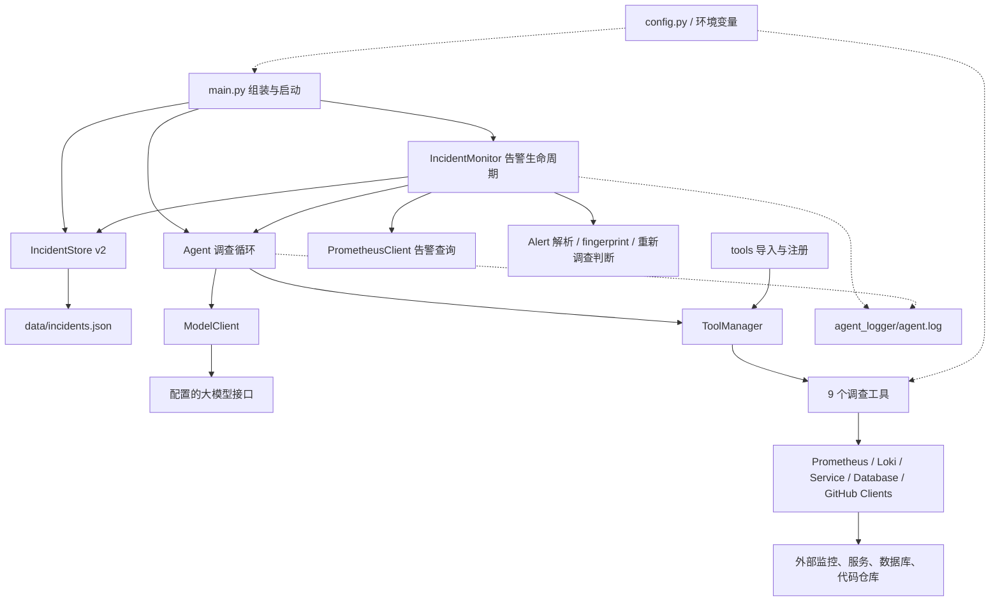

# Incident Agent 项目结构与使用说明

整理日期：2026-10-07（Asia/Shanghai）。项目位置：`D:\Incident Agent`。

文档归档说明：README 和 Agent 指令文件 AGENTS 保留固定名称及项目根目录位置，其余说明和报告归入 `docs/`，文件名采用“原名称_yyyy-MM-dd_HH-mm-ss.md”。后缀时间取归档前文件最后修改时间，并转换为 Asia/Shanghai；它不是移动操作的时间。后续新增与更新文档的规则见 [AGENTS.md](../AGENTS.md)。下文功能与测试结果仍对应首次整理时的代码快照。

本文以整理时的**当前工作区代码**为依据，包含尚未提交的文件；分支为 `main`，当时 HEAD 为 `c746d14`。HEAD 不代表工作区全部内容。首次编写本文时只新增说明文档，未调整目录或修改业务代码、配置、测试及已有报告。核对期间工作区新增了 `remediation/approval.py`，已补入下文；继续开发后的变化需要另行同步。

文中“已实现”来自源码核对；“本次验证”来自本次实际执行；历史报告中的运行结果仅作为历史记录。没有在本次整理中调用真实模型、查询真实监控服务、连接真实数据库或验证线上部署。

## 目录

1. [项目定位与能力范围](#1-项目定位与能力范围)
2. [完整目录结构](#2-完整目录结构)
3. [分层架构与文件职责](#3-分层架构与文件职责)
4. [一次告警的完整处理过程](#4-一次告警的完整处理过程)
5. [数据模型与持久化](#5-数据模型与持久化)
6. [Agent 调查循环与模型调用](#6-agent-调查循环与模型调用)
7. [工具清单与返回语义](#7-工具清单与返回语义)
8. [支持的指标与代码证据](#8-支持的指标与代码证据)
9. [配置、依赖与外部系统](#9-配置依赖与外部系统)
10. [启动、停止与数据查看](#10-启动停止与数据查看)
11. [测试与本次验证结果](#11-测试与本次验证结果)
12. [当前限制、草稿与排查提示](#12-当前限制草稿与排查提示)
13. [阅读顺序与维护位置](#13-阅读顺序与维护位置)

## 1. 项目定位与能力范围

这是一个以 Python 编写的 SRE 故障调查程序。它定期读取 Prometheus 告警，将告警归入 Incident，再由大模型选择工具收集证据、分析故障，并把证据和调查记录写入本地 JSON。

目前入口是命令行常驻轮询程序，没有 Web 页面、对外 HTTP API 或消息通知入口。

当前主流程已实现：

- 读取 firing 告警，按服务和指标生成稳定 fingerprint。
- 首次告警创建 Incident；持续告警复用活动 Incident；满足条件时重新调查。
- 根据完整、有效的告警快照判断恢复。
- 使用 Store v2 保留历史 Incident，并维护活动 Incident 索引。
- 查询 HTTP / PostgreSQL 指标、Loki 日志、服务健康和 PostgreSQL 依赖健康。
- 查询 GitHub 近期提交、指定提交 diff、指定版本源码，以及服务自报的运行版本。
- 管理模型轮数、工具预算、单次调查缓存和跨调查证据去重。
- 记录调查结果、成功调查时间、成功调查时的告警值及运行日志。

当前调查工具只读访问外部系统；数据库探测执行 `SELECT 1`。程序会写自己的 Incident 文件和日志，但没有自动改代码、提交修复、重启服务、回滚或执行修复提案的链路。

`models/remediation.py` 和 `remediation/approval.py` 是未接入主流程的修复提案及审批草稿。模型存在已确认的导入错误，审批函数也引用了不一致的状态属性，不能把它们计入已经完成的修复能力。

## 2. 完整目录结构

以下列出业务文件、文档和重要本地运行目录；`.git/`、编辑器状态、缓存及日志内容不逐项展开。

```text
D:\Incident Agent\
├─ main.py                         # 顶层组装与启动
├─ config.py                       # 模型、监控、依赖、仓库和调度配置
├─ alert_parser.py                 # Prometheus 原始告警 → Alert
├─ fingerprint.py                  # service + metric → SHA-256 fingerprint
├─ incident_factory.py             # 创建新的 Incident
├─ incident_store.py               # Store v2 JSON 读写、活动索引和恢复
├─ reinvestigation.py              # 是否需要重新调查
├─ requirements.txt                # 直接依赖
├─ .env.example                    # 模型密钥的空模板
├─ .env                            # 本地环境变量，Git 忽略
├─ .gitignore                      # 忽略配置、密钥、缓存、日志和运行数据
├─ temp_test.py                     # 手动读取真实 Loki 日志的小脚本
├─ README.md                       # 简介；部分内容仍描述旧版本
├─ AGENTS.md                       # 开发 Agent 的项目约定与文档命名规则
├─ docs/                           # 说明文档与历史报告，文件名含原修改时间
│  ├─ REGRESSION_REPORT_2026-10-06_14-32-43.md
│  ├─ CODE_EVIDENCE_REPORT_2026-10-07_17-04-57.md
│  ├─ PROJECT_GUIDE_2026-10-07_18-16-15.md
│  ├─ REMEDIATION_GUIDE_2026-10-07_19-04-33.md
│  ├─ REMEDIATION_VALIDATION_2026-10-07_19-07-56.md
│  ├─ SERVICE_REGISTRY_GUIDE_2026-10-08_10-41-45.md
│  └─ SERVICE_REGISTRY_VALIDATION_2026-10-08_10-43-29.md
│
├─ monitor/
│  ├─ __init__.py
│  └─ incident_monitor.py           # 告警生命周期与调查调度
├─ agent/
│  ├─ __init__.py
│  └─ agent.py                      # 模型/工具循环、预算、缓存、证据
├─ model_client/
│  ├─ __init__.py
│  ├─ model_client.py               # 模型接口与错误分类重试
│  └─ retry.py                      # 指数等待
├─ models/
│  ├─ __init__.py
│  ├─ incident.py                   # Alert、Evidence、Incident
│  ├─ investigation.py              # 调查状态、返回结果、历史记录
│  └─ remediation.py                # 未跟踪的修复提案草稿，未接入
├─ remediation/
│  └─ approval.py                   # 核对期间新增的审批函数草稿，未接入
├─ prompts/
│  ├─ __init__.py
│  └─ agent_prompt.py               # 证据规则、工具选择与结论要求
├─ tools/
│  ├─ __init__.py                   # 导入并注册全部 9 个调查工具
│  ├─ tool_registry.py              # @tool 注册和 schema 生成
│  ├─ tool_manager.py               # 执行调用、捕获异常、构造工具输出
│  ├─ metrics.py                    # HTTP / PostgreSQL 指标工具
│  ├─ logs.py                       # Loki 日志工具与纳秒 UTC 转换
│  ├─ health.py                     # 服务健康工具
│  ├─ dependencies.py               # 依赖拓扑与数据库健康工具
│  ├─ version.py                    # 服务运行版本工具
│  ├─ code_changes.py               # 近期提交、diff、源码工具
│  └─ prometheus.py                 # 空文件，目前无功能
├─ clients/
│  ├─ __init__.py
│  ├─ prometheus_client.py          # Prometheus HTTP 请求
│  ├─ loki_client.py                # Loki HTTP 请求
│  ├─ service_client.py             # 服务 /health 与 /version 请求
│  ├─ database_client.py            # DNS、TCP、PostgreSQL 与 SELECT 1 探测
│  └─ github_client.py              # GitHub 只读 HTTP 请求
├─ agent_logger/
│  ├─ __init__.py
│  ├─ logger_config.py              # 文件日志配置
│  └─ agent.log                     # 本地运行日志，Git 忽略
├─ tests/
│  ├─ test_incident_regression.py   # 58 项生命周期与指标测试
│  └─ test_code_evidence.py         # 38 项代码证据等测试
├─ data/
│  └─ incidents.json               # 本地 Incident 数据，Git 忽略
├─ .vscode/                        # 本地编辑器配置，Git 忽略
├─ __pycache__/                    # Python 缓存，Git 忽略
└─ .git/                           # Git 元数据
```

除 `tools/__init__.py` 外，上述各包的 `__init__.py` 当前均为空，主要用于标识 Python 包。Python 缓存也可能出现在各子目录中。

`D:\prometheus-demo` 是独立的相关服务项目，**不是本项目子目录**。本项目通过配置的 URL、指标、日志及 GitHub 仓库读取它的观测信息。这里没有部署 Prometheus、Loki、PostgreSQL 或 Demo 的脚本，也没有 Docker Compose 文件。

## 3. 分层架构与文件职责



### 3.1 入口、调度与存储

| 文件 | 核心职责 | 边界 |
| --- | --- | --- |
| [main.py](../main.py) | 加载 `.env`，创建 OpenAI SDK 客户端、Agent、PrometheusClient、IncidentStore、IncidentMonitor，调用 `monitor.run()` | 只负责组装，不承担根因分析；代码在模块顶层运行 |
| [config.py](../config.py) | 保存模型名、预算、轮询间隔、服务地址、数据库探测、监控目标、拓扑、仓库映射 | 大部分配置不是环境变量 |
| [monitor/incident_monitor.py](../monitor/incident_monitor.py) | 校验告警快照，处理活动 Incident，调度调查，保存结果，标记恢复 | 不自行选择调查工具或生成根因结论 |
| [alert_parser.py](../alert_parser.py) | 只接受 firing 告警，并转换字段/数值 | 不读取 Prometheus 规则，也不验证业务阈值是否真的被突破 |
| [fingerprint.py](../fingerprint.py) | 对 `service|metric` 做 SHA-256 | 不包含实例、severity、threshold 或 value |
| [incident_factory.py](../incident_factory.py) | 生成 `inc-` 加 UUID 前 8 位的 ID，创建初始 Incident | 初始状态为 `investigating` |
| [reinvestigation.py](../reinvestigation.py) | 根据上次成功调查时间、值和指标恶化判断是否重新调查 | 当前只对 `http_5xx_rate` 定义提前重查规则 |
| [incident_store.py](../incident_store.py) | 以 Incident ID 保留历史，按 fingerprint 索引活动 Incident | 文件存储，不是数据库；没有自动旧格式迁移 |

### 3.2 调查、模型与工具调度

| 文件 | 核心职责 |
| --- | --- |
| [agent/agent.py](../agent/agent.py) | 创建调查上下文，循环请求模型，执行工具，管理调用预算、缓存和 Evidence，返回 `InvestigationResult` |
| [model_client/model_client.py](../model_client/model_client.py) | 调用 SDK 的 `responses.create()`，对连接、限流和部分服务错误重试 |
| [model_client/retry.py](https://github.com/yuj1ng1/incident-agent/blob/edca46f79805135e65a819829373c847828a02a1/model_client/retry.py) | 按 `2 ** attempt` 秒等待 |
| [prompts/agent_prompt.py](../prompts/agent_prompt.py) | 定义 51 条调查规则，强调证据、工具信息价值、时间基准、代码因果证据及只读约束 |
| [tools/tool_registry.py](../tools/tool_registry.py) | 用 `@tool` 将函数和 schema 加入全局 `tool_registry`；通过签名、类型注解及 docstring 生成参数说明 |
| [tools/tool_manager.py](../tools/tool_manager.py) | 查找工具，解析 JSON 参数，执行函数，记录耗时，转换为模型需要的 `function_call_output` |
| [tools/__init__.py](../tools/__init__.py) | 导入工具模块，使带 `@tool` 的函数完成注册 |
| [agent_logger/logger_config.py](../agent_logger/logger_config.py) | 创建名为 `agent` 的 INFO 级别文件 logger，使用 UTF-8 输出 |

`main.py` 在加载 `.env` 后导入 `tools`。其他入口直接使用 Agent 时，也需要确保工具模块已导入；正常包导入会执行 `tools/__init__.py`。辅助函数没有 `@tool`，不会暴露给模型。

### 3.3 外部访问客户端

| 文件 | 外部访问 | 当前行为 |
| --- | --- | --- |
| [clients/prometheus_client.py](../clients/prometheus_client.py) | `/api/v1/alerts`、`/api/v1/query` | GET，超时 5 秒，非成功 HTTP 状态抛出异常 |
| [clients/loki_client.py](../clients/loki_client.py) | `/loki/api/v1/query_range` | GET，超时 5 秒，`direction=backward`，默认取 50 条 |
| [clients/service_client.py](../clients/service_client.py) | 配置服务的 `/health`、`/version` | GET，超时 5 秒；保留 HTTP 状态，供工具解释 |
| [clients/database_client.py](../clients/database_client.py) | DNS、TCP、PostgreSQL | TCP 超时 3 秒，数据库连接超时 3 秒，连接成功后执行 `SELECT 1` |
| [clients/github_client.py](../clients/github_client.py) | 配置 GitHub 仓库的 commits、contents | GET，超时 5 秒；超大源码使用受限流式前缀读取；Token 在请求时读取 |

Client 处理协议访问，Tool 将结果转换为调查语义，Agent 使用结果分析，Monitor 决定何时调用 Agent。

## 4. 一次告警的完整处理过程

### 4.1 告警输入契约

下面是与现有测试相同形式的**构造示例**，不是本次真实采集结果：

```json
{
  "state": "firing",
  "labels": {
    "service": "order-service",
    "metric": "http_5xx_rate",
    "severity": "critical"
  },
  "annotations": {
    "threshold": "0.20"
  },
  "value": "0.27"
}
```

解析器要求 `labels.service`、`labels.metric`、`labels.severity`、`annotations.threshold` 和顶层 `value` 存在；后两项必须能转为 float。`pending`、`inactive` 等非 firing 告警返回 `None`。

这些字段是本项目的输入要求，不是可以自动假设存在的字段。项目没有提供告警规则配置；接入时应核对上游字段，并确认原始 `value` 表示预期业务指标。解析器直接使用这个值，不会先查询指标来修正它。

### 4.2 每轮处理顺序

1. `process_alerts_once()` 调用 `get_alerts()`。
2. 检查响应是 dict、`status == "success"`，并且 `data.alerts` 是 list。
3. 对每个 firing 告警生成 `sha256("service|metric")`，加入当前活动 fingerprint 集合。
4. 查询 `get_active_incident(fingerprint)`。
5. 没有活动 Incident 时创建新对象，并先保存，再开始调查。
6. 有活动 Incident 时判断是否重查；需要时追加 Alert，先保存，再开始调查；不需要时直接返回。
7. 调查正常返回后追加 `InvestigationRecord`；仅成功调查更新 `last_investigated_at/value`。
8. 全部告警处理完成后，Store 将不在本轮 firing 集合中的活动 Incident 标记为 `resolved`，保留历史并移除活动索引。
9. 本轮完成后等待 30 秒，再进入下一轮。

响应整体无效时跳过本轮告警处理和恢复判断，避免把查询失败解释成“没有告警”。有效空列表则会触发恢复；一个先前 firing 的告警变成 pending，也会被当前规则视为恢复。

### 4.3 重新调查规则

| 条件 | 是否重查 |
| --- | --- |
| 没有上次成功调查时间 | 是 |
| 没有上次成功调查值 | 是 |
| `http_5xx_rate` 相比上次成功调查值增加至少 0.2 | 是，可提前绕过冷却 |
| 距上次成功调查已满 5 分钟 | 是 |
| 其他情况 | 否 |

0.2 是绝对差值：例如 0.50 → 0.70，而不是相对增长 20%。阈值边界使用绝对容差 `1e-12` 的 `math.isclose`，处理浮点表示误差。其他指标当前只按成功调查记录与冷却判断。

失败不会更新时间和值，所以从未成功的 Incident 可以在下一轮再次尝试；已经超过冷却的 Incident 失败后，也可能每轮继续尝试。

### 4.4 两种状态不能混用

Incident 生命周期状态和调查执行状态分别记录：

- `incident.status`：当前实际写入的是 `investigating` 或 `resolved`。
- 调查状态：`completed`、`max_round_reached` 或 `model_incomplete`。

调查成功表示本轮模型给出了最终回答，**不会**把 Incident 改为 resolved。resolved 来自后续有效告警快照中 firing 告警的消失。

调查中抛出异常时，Monitor 记录异常并保存已收集的 Evidence，不新增本轮 `InvestigationRecord`，也不覆盖上次成功时间和值。Agent 调查异常被局部捕获，其他告警可继续处理；告警解析、Store 等其他异常可能中断整轮，再由 `run()` 捕获，等待后继续。

## 5. 数据模型与持久化

### 5.1 模型定义

模型使用 Pydantic 2，来源为 [models/incident.py](../models/incident.py) 和 [models/investigation.py](../models/investigation.py)。

| 模型 | 字段 | 含义 |
| --- | --- | --- |
| `Alert` | `service, metric, value, threshold, severity` | 一条解析后的业务告警 |
| `Evidence` | `source, summary, detail` | 工具名称、简要说明和 JSON 字符串形式的工具结果 |
| `Incident` | `incident_id, fingerprint, service, severity, status` | 事件标识、聚合身份和生命周期 |
| `Incident` | `alerts, evidence, investigations` | 已保存告警、证据及历次调查记录 |
| `Incident` | `last_investigated_at, last_investigated_value` | 最近一次成功调查的时间和值；未成功时可为 `None` |
| `InvestigationResult` | `success, status, answer` | Agent 返回 Monitor 的本次执行结果 |
| `InvestigationRecord` | `investigated_at, status, alert_value, answer` | 保存进 Incident 的一次调查历史 |
| `RemediationProposal`（草稿） | `proposal_id, incident_id, summary, reason, action_type, parameters, risk, status` | 拟议修复建议；目前无法正常导入，未关联到 Incident 存储 |

`evidence`、`investigations` 使用独立空列表默认值；反序列化时，这两个字段的 `null` 会转成空列表。`fingerprint` 在模型层可为空，但正常创建和保存流程会设置它。

Incident 本身没有独立的 `created_at`、`resolved_at`、部署时间或 Alert 采集时间字段。调查时间由 `datetime.now()` 产生，未携带时区。

### 5.2 Store v2 格式

新文件的初始内容是：

```json
{
  "version": 2,
  "incidents": {},
  "active_by_fingerprint": {}
}
```

有数据后，两部分的关系是：

```text
incidents[incident_id] = 完整 Incident 的 JSON 对象
active_by_fingerprint[fingerprint] = 当前未恢复的 incident_id
```

同一 fingerprint 在恢复后再次 firing，会得到新的 Incident ID；旧记录继续留在 `incidents`，活动索引改为指向新 ID。

| Store 方法 | 职责 |
| --- | --- |
| `create_empty_data()` | 生成 v2 空结构 |
| `load()` / `save(data)` | 读取 / 覆盖写入完整 JSON 文件 |
| `get_active_incident(fingerprint)` | 根据活动索引返回未 resolved 的 Pydantic Incident |
| `save_incident(fingerprint, incident)` | 按 ID 保存；同步设置或移除活动索引 |
| `resolve_inactive_incidents(active_fingerprints)` | 标记不再 firing 的活动记录为 resolved，返回恢复的 ID 列表 |

当前没有旧版根节点格式迁移逻辑。`load()` 只解析 JSON，没有根据 `version` 做升级或严格版本检查；调用方法直接依赖 v2 的两个字典存在。

Store 使用 `model_dump(mode="json")` 序列化日期和枚举。`Evidence.detail` 是 JSON 字符串，所以在外层文件中看到转义引号是正常现象；需要查看内部字段时再解析该字符串。

### 5.3 文件位置与保存时机

- 默认数据路径为相对路径 `data/incidents.json`，相对于**启动进程的工作目录**。
- Store 初始化会创建父目录；仅在文件不存在时写入空结构。
- 调查前保存一次，正常结果处理后再次保存；调查异常也保存已收集内容。
- 日志路径使用 `logger_config.py` 所在目录定位，固定为项目内 `agent_logger/agent.log`。

从不同目录执行 `main.py` 可能在不同位置创建数据文件，而日志仍写在本项目内。启动前应切到项目根目录。

## 6. Agent 调查循环与模型调用

### 6.1 调查上下文与循环

每次 `investigate(incident)` 会清空本次 `history`、工具缓存和调用计数。新的用户提示包含 Incident 的基础信息、告警、已有 Evidence 和历史调查结论，所以业务历史通过 Incident 传递；模型请求历史不跨调查保留。

每轮流程如下：

1. 在系统 instructions 中加入剩余工具次数和剩余模型响应轮数。
2. 有预算时提供全部工具 schema，预算用完后提供空工具列表。
3. 通过 `ModelClient` 请求模型。
4. 如果响应 `status != "completed"`，返回失败状态 `model_incomplete`，不执行其中工具。
5. 如果没有 `function_call`，把 `output_text` 作为最终回答，返回成功状态 `completed`。
6. 如果有工具调用，将完整 `response.output` 追加到历史，再逐个执行调用，将对应输出追加到历史，并尝试保存 Evidence。
7. 7 轮后仍未形成最终回答，返回失败状态 `max_round_reached`。

这里使用完整本地历史作为 `input`，没有使用 `previous_response_id`。只有 `function_call` 项用于工具执行和 `call_id` 关联；reasoning 等其他输出项可以保留在历史里。

Prompt 允许模型同轮提出多个独立工具调用，但当前 Python 实现用 `for` 循环**顺序执行**这些调用，没有并发执行器。最后一轮不要再调用工具是提示要求；代码没有专门在最后一轮强制禁用工具。

### 6.2 预算、缓存和去重

- 每次调查最多 7 次模型响应轮次。
- 最多 13 次非缓存的工具执行尝试；失败执行也消耗次数。
- 缓存键为工具名加排序后的 JSON 参数；参数键顺序不影响缓存命中。
- 同一次调查命中缓存不增加工具计数，也不再次加入 Evidence。
- ToolManager 正常返回即视为执行成功，因此 `no_data` 结果也可能缓存；但它不会成为 Evidence。
- 跨调查不保留工具缓存；会重新访问外部系统。
- Evidence 去重比较工具来源和规范化后的完整结果 JSON；结果变化就会新增。

只有同时满足“执行成功、非缓存、结果为 dict、`status == "ok"`、不是重复结果”才加入 Evidence。`no_data`、工具异常和预算超限输出仍会进入本次模型历史，但不写入 Evidence 列表。

### 6.3 模型重试

`main.py` 使用 OpenAI SDK 创建客户端，`base_url` 配置为 `https://api.deepseek.com`，模型名来自 `MODEL_NAME`。这是当前代码的调用配置；本次未重新确认外部接口或模型服务是否可用。

SDK 层 `max_retries=0`，由 `ModelClient` 控制每次请求最多 **3 次总尝试**，不是额外重试 3 次。默认两次重试前分别等待 1 秒和 2 秒。

| 异常类别 | 当前处理 |
| --- | --- |
| `APIConnectionError` | 可重试，最终失败向上抛出 |
| `RateLimitError` | 可重试，最终失败向上抛出 |
| HTTP 400 / 401 / 402 / 403 / 404 / 422 | 立即抛出，不重试 |
| HTTP 5xx | 可重试，最后一次失败抛出 |
| 其他 `APIStatusError` | 立即抛出 |

模型接口失败最终由 Monitor 的调查异常分支记录。`completed` 只表示执行流程得到了最终回答，不是对根因正确性或回答内容完整性的程序化认证。

## 7. 工具清单与返回语义

### 7.1 全部 9 个注册工具

| 工具 | 参数 | 来源文件 / 数据来源 | 主要输出 |
| --- | --- | --- | --- |
| `query_metrics` | `service, metric` | [tools/metrics.py](../tools/metrics.py) / Prometheus | `value, promql` 或 `no_data` |
| `query_logs` | `service` | [tools/logs.py](../tools/logs.py) / Loki | 最多 50 条 `timestamp, timestamp_utc, line, labels` |
| `check_service_health` | `service` | [tools/health.py](../tools/health.py) / 服务 `/health` | `health, http_status, message` |
| `get_service_dependencies` | `service` | [tools/dependencies.py](../tools/dependencies.py) / 本地拓扑配置 | `dependencies` |
| `check_dependency_health` | `dependency` | [tools/dependencies.py](../tools/dependencies.py) / 主动数据库探测 | `reachable` 和分阶段检查结果 |
| `get_recent_code_changes` | `service` | [tools/code_changes.py](../tools/code_changes.py) / GitHub | 最多 5 条提交，含 SHA、message、author、committed_at |
| `get_running_version` | `service` | [tools/version.py](../tools/version.py) / 服务 `/version` | 完整 SHA、短 SHA、UTC 启动时间、允许的运行开关 |
| `get_commit_diff` | `service, commit_sha` | [tools/code_changes.py](../tools/code_changes.py) / GitHub | 提交信息、文件变更、patch、截断标记 |
| `get_source_file` | `service, path, ref` | [tools/code_changes.py](../tools/code_changes.py) / GitHub | 指定 ref 的 UTF-8 文本、大小、blob SHA、截断标记 |

### 7.2 返回状态的解释

| 状态 / 字段 | 含义 |
| --- | --- |
| `status="ok"` | 工具取得了可解释的结果，不代表被检查服务正常 |
| `status="no_data"` | 未获得该项数据；结合 `reason` 或 `message` 判断原因 |
| `reachable=false` 且 `status="ok"` | 有效故障观测：当前探测路径无法完成数据库连接和查询 |
| `value=0` 且 `status="ok"` | 有效的有限数值，不能一律当成无数据 |
| `tool_not_found` | 模型请求了未注册工具 |
| `invalid_arguments` | 工具参数不是可解析的 JSON |
| `tool_error` | 工具执行抛出异常 |
| `tool_limit_reached` | 当前调查工具预算已用完 |

`check_service_health` 保留 HTTP 状态，非 2xx 并不一定导致工具执行失败；`health="unknown"` 也可能和 `status="ok"` 同时出现。应看具体字段，不要仅看 `ok`。

数据库主动检查依次记录 `dns_resolved`、`tcp_reachable`、`database_connected`、`query_ok`。失败时可带 `failure_stage`、`error_type`、`message`；`reachable` 要求数据库连接和 `SELECT 1` 均成功。

`query_logs` 使用 `{service="指定服务"}` 查询；保留原始纳秒 timestamp，按整数拆分秒和纳秒生成 UTC `timestamp_utc`，必要时保留 9 位小数，再按原始 timestamp 从新到旧排序。它没有显式传入 Incident 的起止时间，得到的是近期日志，不保证每一条都属于当前故障窗口。

## 8. 支持的指标与代码证据

### 8.1 HTTP 指标

| 指标名 | 当前 PromQL 含义 | 注意事项 |
| --- | --- | --- |
| `http_requests_total` | 汇总服务的 `demo_http_requests_total` | 累计请求数，不直接表示当前流量 |
| `http_request_rate` | 汇总该计数器最近 1 分钟 `rate` | 请求速率 |
| `http_5xx_rate` | 最近 1 分钟 `status="500"` 的请求速率 / 全部请求速率 | 当前实现只统计 500，名称不能当成包含所有 5xx |

HTTP 指标按服务标签汇总，没有区分实例。没有流量时分母可能为零；返回的 NaN / Infinity 会被工具转换为 `no_data`，不能解释为错误率为零。

### 8.2 PostgreSQL 指标

这些指标使用 `MONITORING_TARGETS[service]` 中的 `type, job, database` 配置；当前 `order-db` 对应 `type=postgresql, job=postgres, database=orders`。工具会校验配置并转义标签值。

| 指标名 | 依赖的采集指标 / 含义 |
| --- | --- |
| `postgres_up` | `pg_up`，exporter 当前访问 PostgreSQL 的结果 |
| `postgres_connections` | 汇总指定数据库的 `pg_stat_database_numbackends` |
| `postgres_max_connections` | 实例的 `pg_settings_max_connections` |
| `postgres_connection_usage` | 按 job / instance 汇总所有非空数据库连接数，再除以同实例最大连接数；返回比例，不乘 100 |
| `postgres_active_sessions` | 指定数据库 `pg_stat_activity_count` 中的 active 会话 |
| `postgres_idle_sessions` | 同一数据库的 idle 会话 |
| `postgres_idle_in_transaction` | 同一数据库的 idle in transaction 会话 |
| `postgres_lock_waits` | 同一数据库等待 Lock 的会话；仅在已有 activity 样本且 `pg_up == 1` 时允许补零 |

`query_metrics` 要求查询结果恰好 1 条且数值有限：空结果、多个结果、不支持的指标或目标配置错误返回 `no_data`。实例级结果有多条时不会静默取第一条。

`postgres_up` 和 `check_dependency_health` 观测路径不同：前者来自 exporter，后者来自 Agent 所在机器。结果不一致时，应检查网络、认证和配置差异。两者成功也不能排除锁、资源压力或特定 SQL 等其他数据库问题。

### 8.3 GitHub 与运行版本

GitHub 仓库只能通过 `CODE_REPOSITORIES` 的服务映射选择；模型不能传入任意 `repo`。Token 从 `GITHUB_TOKEN` 读取，没有新增 GitHub SDK 或写操作。

| 工具 | 当前边界 |
| --- | --- |
| `get_recent_code_changes` | 配置分支最近最多 5 个提交；message 最多 2000 字符；时间使用 `committer.date` |
| `get_running_version` | 只接受 40 位十六进制 SHA；启动时间必须明确 UTC；仅允许布尔开关 `simulate_code_regression` |
| `get_commit_diff` | 输入 SHA 为 7～40 位十六进制；最多 15 个文件、单 patch 6000 字符、全部 patch 合计 24000 字符 |
| `get_source_file` | 仓库内相对路径、指定 ref、UTF-8 文本；最多 20000 字符；大于 1,000,000 字节的特殊响应读取最多 80004 字节 raw 前缀 |

diff 显式返回 `patch_available`、`truncated`、`files_truncated`。缺失 patch、分页或截断不能被解释为没有相应逻辑。

源码读取拒绝绝对路径、目录穿越、目录、symlink 和不支持的编码。查询当前运行逻辑时应使用服务报告的完整运行 SHA；函数也允许其他合法 Git ref，但分支内容不能自动当成正在运行的源码。

`get_running_version` 在 SHA unknown 时可保留有效启动时间和开关，但整体仍返回 `no_data`；不能据此补猜运行版本。

代码证据应逐步连接：

```text
运行时异常 / 指标 / 依赖证据
    → 值得验证的近期提交
    → 被探测实例自报的运行 SHA 和开关
    → 疑似引入逻辑的 diff
    → 必要时核对运行 SHA 下的源码
    → 结合日志判断故障路径是否实际触发
```

提交存在不证明已部署；服务自报 SHA 不等于独立制品认证；进程启动时间不等于部署时间；源码含有路径也不证明该路径在当前 Incident 中执行。多实例、观测窗口不一致、SHA 配置错误、截断或缺失数据都应保留为不确定项。

## 9. 配置、依赖与外部系统

### 9.1 当前调度与模型配置

以下值来自整理时的 [config.py](../config.py)。

| 配置项 | 当前值 | 作用 |
| --- | --- | --- |
| `MODEL_NAME` | `deepseek-flash` | 模型请求名称 |
| `MAX_AGENT_LOOPS` | 7 | 每次调查的模型响应轮数上限 |
| `MAX_TOOL_CALLS` | 13 | 每次调查非缓存工具执行次数上限 |
| `MODEL_RETRIES` | 3 | 每次模型请求总尝试次数 |
| `ALERT_POLL_INTERVAL_SECONDS` | 30 | 一轮处理结束后的等待秒数 |
| `REINVESTIGATE_COOLDOWN_MINUTES` | 5 | 两次成功调查之间的冷却判断 |
| `HTTP_5XX_RATE_INCREASE_THRESHOLD` | 0.2 | 相对上次成功调查值的绝对增量阈值 |
| `PROMETHEUS_URL` | `http://localhost:9090` | 告警与指标来源 |
| `LOKI_URL` | `http://localhost:3100` | 日志来源 |

“每 30 秒”不是严格固定周期。调查和请求是同步执行的，实际相邻轮询开始时间间隔为本轮处理耗时加 30 秒。

### 9.2 服务、监控目标、依赖与仓库映射

| 配置 | 当前关联 | 用途 |
| --- | --- | --- |
| `SERVICE_URLS` | `order-service → http://localhost:8001` | `/health` 和 `/version` |
| `SERVICE_DEPENDENCIES` | `order-service → order-db`；`order-db → []` | 静态依赖拓扑 |
| `MONITORING_TARGETS` | `order-db → postgresql / postgres / orders` | exporter 指标标签选择 |
| `DEPENDENCIES` | `order-db → PostgreSQL / 127.0.0.1:5432 / orders` | Agent 主动连接探测；包含本地演示账号配置 |
| `CODE_REPOSITORIES` | `order-service → github / yuj1ng1/prometheus-demo / codex/postgres-monitoring` | GitHub 近期提交分支和仓库白名单 |

`MONITORING_TARGETS` 是监控路径配置，`DEPENDENCIES` 是主动连接路径配置；它们不能互相替代。本文不重复展示数据库密码或真实环境变量值。

### 9.3 环境变量

| 变量 | 读取方式 | 要求 |
| --- | --- | --- |
| `DEEPSEEK_API_KEY` | `main.py` 的 `load_dotenv()` 与 `os.getenv()` | 创建模型客户端需要非空值；真实调查还需要有效密钥 |
| `GITHUB_TOKEN` | `GithubClient.headers()` 每次请求时延迟读取 | 按配置仓库的访问需要提供；无 Token 时仍会发出不带认证的请求，能否读取取决于仓库与接口响应 |

`.env.example` 当前只列出空的 `DEEPSEEK_API_KEY`，没有 `GITHUB_TOKEN` 模板。实际需要代码证据查询时，可在本地 `.env` 中自行补充；本次没有修改模板或环境变量。

### 9.4 Python 依赖与已核实环境

| requirements.txt 项目 | 用途 | 本次 agentlearn 中的版本 |
| --- | --- | --- |
| `openai` | 模型 SDK 与响应对象 | 3.14.0 |
| `python-dotenv` | 加载本地环境变量 | 1.2.3 |
| `pydantic>=2,<3` | 数据模型和序列化 | 2.13.5 |
| `requests` | HTTP 请求 | 2.34.2 |
| `psycopg[binary]` | PostgreSQL 连接探测 | 3.3.6 |

本次解释器：`D:\conda\envs\agentlearn\python.exe`，Python 3.12.14。直接依赖清单不是锁文件，除 Pydantic 主版本约束外未锁定版本；这里只确认上述环境下的测试结果，不宣称所有 Python / 依赖组合均兼容。

## 10. 启动、停止与数据查看

以下是给使用者的操作说明，本次整理没有启动生产轮询或安装依赖。

### 10.1 准备

在 PowerShell 中切换到项目根目录，并核对使用的解释器：

```powershell
Set-Location -LiteralPath 'D:\Incident Agent'
& 'D:\conda\envs\agentlearn\python.exe' --version

# 环境缺少依赖时再安装：
& 'D:\conda\envs\agentlearn\python.exe' -m pip install -r requirements.txt

# 仅在 .env 不存在时创建，避免覆盖本地配置：
if (-not (Test-Path -LiteralPath '.env')) {
    Copy-Item -LiteralPath '.env.example' -Destination '.env'
}
```

在本地 `.env` 填入所需密钥；核对 `config.py` 的地址、拓扑、数据库探测和仓库映射。准备可用的 Prometheus 告警/指标、Loki 日志和被调查服务。数据库内部指标还依赖对应 exporter 采集。

### 10.2 启动与停止

```powershell
Set-Location -LiteralPath 'D:\Incident Agent'
& 'D:\conda\envs\agentlearn\python.exe' -B main.py
```

程序将持续轮询。没有 firing 告警时会继续检查；有需要调查的告警时会调用模型并打印结论。用 `Ctrl+C` 停止，主循环捕获 `KeyboardInterrupt` 后输出停止信息。

`main.py` 没有 `if __name__ == "__main__"` 保护，普通 `import main` 也会创建对象并启动循环。它不适合作为无副作用的库模块导入。

### 10.3 查看运行结果

```powershell
# 查看最近运行日志：
Get-Content -LiteralPath 'D:\Incident Agent\agent_logger\agent.log' -Tail 60

# 查看 Incident 摘要：
$incidentData = Get-Content -LiteralPath 'D:\Incident Agent\data\incidents.json' -Raw | ConvertFrom-Json
$incidentData.incidents.PSObject.Properties | ForEach-Object {
    $_.Value | Select-Object incident_id, service, severity, status, last_investigated_at
}

# 查看活动 fingerprint 到 Incident ID 的映射：
$incidentData.active_by_fingerprint
```

`temp_test.py` 当前直接查询 `order-service` 的 Loki 日志并打印前 10 条原始 line，不是自动化测试。执行它会访问真实 Loki，应和 `tests/` 的隔离测试区分。

## 11. 测试与本次验证结果

### 11.1 当前测试构成

| 文件 / 测试类 | 数量 | 主要覆盖 |
| --- | --- | --- |
| `test_incident_regression.py / IncidentRegressionTests` | 35 | 入口组装、告警解析、fingerprint、创建/复用/恢复、v2 历史保留、重查、结果/证据/异常保存 |
| `test_incident_regression.py / MetricsRegressionTests` | 23 | HTTP PromQL、PostgreSQL 配置与 PromQL、零值、空结果、非有限值、多结果等 |
| `test_code_evidence.py / VersionTests` | 9 | SHA、UTC 时间、开关白名单、服务版本接口异常 |
| `test_code_evidence.py / DiffTests` | 9 | 仓库与 SHA、文件/patch 限制、分页、缺失 patch、HTTP/结构错误 |
| `test_code_evidence.py / SourceTests` | 10 | ref、路径、类型、编码、前缀、大小、缺失或不完整响应 |
| `test_code_evidence.py / ClientAndLogTests` | 10 | 只读请求、字节上限、纳秒 UTC、排序、提交时间、工具注册、调查预算 |
| **合计** | **96** | 本次全部通过 |

测试替换外部响应、调查时钟和轮询等待；Incident 写入临时目录。入口测试显式设置占位密钥，不需要真实模型密钥。

### 11.2 本次实际执行方式

为确保工具模块首次导入时日志已被隔离，本次先导入现有回归测试模块，再执行 discovery：

```powershell
Set-Location -LiteralPath 'D:\Incident Agent'
$incidentTestScript = @'
import sys
import unittest
sys.path.insert(0, "tests")
import test_incident_regression
suite = unittest.defaultTestLoader.discover("tests")
result = unittest.TextTestRunner(verbosity=1).run(suite)
sys.exit(0 if result.wasSuccessful() else 1)
'@
& 'D:\conda\envs\agentlearn\python.exe' -B -c $incidentTestScript
```

本次结果：`Ran 96 tests`、`OK`、退出码 0。没有新增或改写测试。

普通命令 `python -B -m unittest discover -s tests -v` 也能发现这些用例，但 `test_code_evidence.py` 会在回归模块的日志隔离之前导入 `tools`，后续 Agent 测试可能写入项目业务日志。需要严格隔离日志时使用上面的实际验证方式。此处不修改测试导入逻辑。

### 11.3 验证边界

- 本次验证了现有 96 项隔离测试和当前解释器/直接依赖版本。
- 单独导入 `models.remediation`，确认出现 `AttributeError`：`RemediationStatus` 没有 `PENDING`。
- 核对整理开始时的 47 个已有项目文件，SHA-256 全部保持一致；首次整理只创建 `PROJECT_GUIDE.md`（现已归档并加时间后缀）。核对期间另行出现的 `remediation/approval.py` 仅被读取并补入说明。
- 没有验证真实 Prometheus / Loki / PostgreSQL / GitHub / 模型服务的当前状态。
- 没有重新执行 [CODE_EVIDENCE_REPORT_2026-10-07_17-04-57.md](CODE_EVIDENCE_REPORT_2026-10-07_17-04-57.md) 中的历史故障模拟或真实 Agent 调查。
- 96 项测试未覆盖修复提案草稿，因此“96 项通过”与“草稿无法导入”可以同时成立。

## 12. 当前限制、草稿与排查提示

### 12.1 已确认的实现限制

| 事项 | 当前事实与影响 |
| --- | --- |
| 修复提案草稿 | `RemediationStatus` 定义的是 `PENGING="penging"`，模型默认值引用不存在的 `PENDING`，导入时失败；`REJECTED` 的实际字符串是 `reject`。主流程没有引用、生成、审批、执行或保存该模型 |
| 审批函数草稿 | `remediation/approval.py` 导入上述模型，并定义 `approve()` / `reject()`；赋值引用 `RemediationProposal.APPROVEd` / `RemediationProposal.REJECT`，与模型字段及 `RemediationStatus` 枚举不一致。依赖导入已失败，当前函数没有可用的主流程集成 |
| 数据库客户端重复定义 | `database_client.py` 中定义了两次同名 `DatabaseClient`；Python 最终使用后一个带 `health()` 的定义。当前测试通过不代表重复定义已清理 |
| Store 文件写入 | 每次读写整个文件，没有锁、原子替换、损坏恢复或多进程协调；多个 Monitor 共用同一数据文件可能发生覆盖或读写冲突 |
| Store 版本 | 不迁移旧格式，也不严格检查 version；JSON 损坏或结构不符会导致处理异常 |
| Incident 聚合 | fingerprint 只含 service / metric。同服务同指标的不同实例或规则会聚合；当前没有租户、环境、实例维度 |
| Alert 保存 | 冷却内跳过调查的告警不会追加到 `alerts`；Incident 的 severity 是创建时值，重查并不更新该字段 |
| 告警校验范围 | 只严格检查快照外层；单条告警缺字段可中断本轮，解析器未额外拒绝 Alert 值中的 NaN / Infinity；指标工具的有限值保护不等于告警解析保护 |
| 恢复语义 | resolved 表示当前有效快照中告警不再 firing，不独立验证业务请求成功，也没有恢复时间字段 |
| 同步执行 | 多个 Incident 和同轮工具顺序执行；慢调查延后其他告警及下一轮轮询 |
| 调查完成语义 | 模型 completed 且没有 function_call 就返回成功，没有对答案非空、栏目或根因证据充分性做结构化校验 |
| 历史增长 | Incident、alerts、evidence、investigations 没有归档/数量上限；Prompt 注入全部已有历史，没有上下文裁剪 |
| 时间与观测范围 | 调查日期无时区，Loki / GitHub / version 则有 UTC 信息；近期日志未绑定 Incident 窗口，不能直接假定精确时间相关性 |
| 证据完备性 | `no_data` / 工具失败只进入模型历史，不进入持久化 Evidence；持久化记录没有独立工具失败审计列表 |
| 服务版本契约 | `/version` 工具要求 Demo 的 `simulate_code_regression` 布尔字段；仅有 SHA 的通用版本接口当前不能直接满足全部校验 |
| Prompt 输出格式 | 第 27 条规定四类栏目，第 51 条又规定五类栏目，存在两套要求；代码并不解析或校验栏目 |
| 日志与凭据 | 日志无轮转；部分工具错误记录原始参数/异常。数据库演示账号在配置中，不能把当前演示配置当成完整生产凭据管理 |

上述是说明和边界记录，没有在本次整理中修复或重构。

### 12.2 已有文档的时效差异

| 文档 | 应如何使用 |
| --- | --- |
| [README.md](../README.md) | 快速了解项目，但其中“35 项测试”、按 fingerprint 覆盖旧 Incident、入口测试需要本地 `.env` 等描述已不符合当前代码；当前为 96 项测试、Store v2 保留历史、入口测试提供占位 Key |
| [REGRESSION_REPORT_2026-10-06_14-32-43.md](REGRESSION_REPORT_2026-10-06_14-32-43.md) | 查看 2026-10-06 当时 35 项测试及回归修复证据，不是当前完整功能清单 |
| [CODE_EVIDENCE_REPORT_2026-10-07_17-04-57.md](CODE_EVIDENCE_REPORT_2026-10-07_17-04-57.md) | 查看 2026-10-07 当时的工具升级和真实实测；包含独立 Demo 的文件与历史运行状态，不能据此确认当前服务还在运行或故障开关仍开启 |
| 本文 | 当前工作区的结构、职责、运行契约、限制和本次隔离验证结果 |

首次整理没有更新这些已有文档。本次归档保留两份历史报告正文，只修正 README 的文档索引以及本说明的目录和相对链接。

### 12.3 常见现象与优先核对点

| 现象 | 优先核对 |
| --- | --- |
| `field_validator` 无法导入 | 实际解释器和 Pydantic 主版本；使用已验证的 agentlearn 环境 |
| 创建模型客户端失败 | `DEEPSEEK_API_KEY` 是否非空、是否通过当前入口加载环境变量 |
| 持续“告警轮询失败” | 先看日志中的具体异常；可能是请求、单条告警、JSON 结构或存储问题，不能直接推断 Prometheus 宕机 |
| 空告警快照后 Incident resolved | 核对快照有效性、上游规则、告警状态；当前恢复只看 firing 集合 |
| PostgreSQL 指标 no_data | `MONITORING_TARGETS`、exporter 指标和标签、空/多结果、非有限值 |
| 主动数据库探测失败 | 根据 failure_stage 区分 DNS / TCP / 数据库连接，并结合实际异常，不直接等同于数据库进程停止 |
| GitHub no_data | 仓库映射、分支/ref、Token 可见范围、HTTP 状态、限流、网络和返回结构 |
| `/version` no_data | HTTP 状态、service 字段、完整 SHA、UTC 启动时间和开关类型 |
| 调查每轮重复尝试 | 是否从未成功，或者上次成功已超过冷却；失败不更新成功时间 |
| 找不到预期数据文件 | 核对进程工作目录，`data/incidents.json` 是相对路径 |
| 隔离测试通过但真实调查失败 | 测试不证明真实密钥、外部接口、模型兼容性、采集配置或服务网络可用 |

## 13. 阅读顺序与维护位置

建议先阅读 `main.py → monitor/incident_monitor.py → models/incident.py → incident_store.py → reinvestigation.py`，理解事件生命周期；再读 `agent/agent.py → tools/tool_manager.py → tools/tool_registry.py → tools/__init__.py`，理解调查循环；最后按需要查看具体 Tool、Client、Prompt 和测试。

| 后续需要了解或维护的内容 | 对应位置 |
| --- | --- |
| 启动与对象组装 | `main.py` |
| 告警字段及身份规则 | `alert_parser.py`、`fingerprint.py` |
| 创建、恢复、重新调查 | `monitor/incident_monitor.py`、`incident_factory.py`、`reinvestigation.py` |
| 数据字段与存储格式 | `models/incident.py`、`models/investigation.py`、`incident_store.py` |
| 模型调用和重试 | `model_client/` |
| 调查预算、缓存、证据 | `agent/agent.py`、`config.py` |
| 工具接口、执行与注册 | `tools/`；新增可用工具还涉及 `tools/__init__.py` |
| 外部协议请求 | `clients/` |
| 新服务/数据库/仓库映射 | `config.py` 的各类映射及外部实际采集配置 |
| 证据边界与结论要求 | `prompts/agent_prompt.py` |
| 回归行为 | `tests/test_incident_regression.py`、`tests/test_code_evidence.py` |
| 修复提案与审批草稿 | `models/remediation.py`、`remediation/approval.py`；当前不可用，尚无执行链路 |

本文是当前状态说明，不代表以上限制已经解决，也不代表相关外部系统已经启动。
