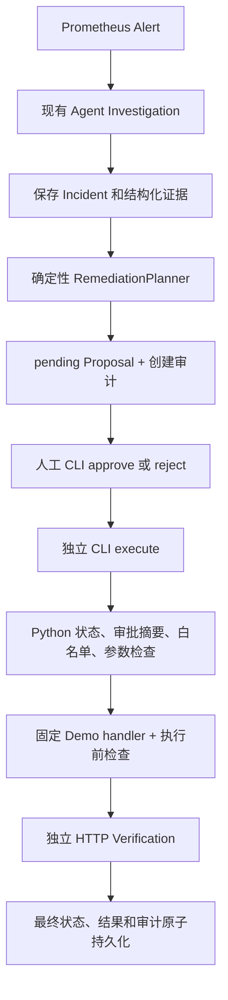

# Human-in-the-loop Remediation

调查、审批和执行在 Python 中分离。唯一真实动作是本机 `order-service` 的
`disable_demo_regression`，风险为 low，仍须独立人工审批。既有调查工具、7 轮／13 次
工具预算、每轮预算提示和 IncidentStore v2 均保持原有行为。



## 人工入口

在 `D:\Incident Agent` 使用 `agentlearn` 环境：

```powershell
python remediation_cli.py list
python remediation_cli.py show <proposal_id>
python remediation_cli.py approve <proposal_id> --by <实际人类身份>
python remediation_cli.py reject <proposal_id> --by <实际人类身份> --reason "继续调查"
python remediation_cli.py execute <proposal_id>
```

默认 Store 为项目根目录的 `data/remediation.json`，不受当前工作目录影响。
本地操作员可在子命令之前指定 `--store <路径>`，用于隔离验证。路径不来自模型。
approve 只保存决策，execute 是单独命令。没有 `input()`，没有默认批准，Monitor 不等待
人类输入。执行命令的审计 actor 取实际 OS 用户名；批准／拒绝完整记录操作员传入的
`--by` 字符串。缺少身份、空身份和控制字符被拒绝。

## Proposal 和结果

模型风格沿用 Pydantic，禁止额外字段并冻结记录；所有时间要求有时区，规范为 UTC
ISO8601（JSON 中为 Z）。修改状态必须生成经校验的新记录。

| Proposal 字段 | 用途 |
| --- | --- |
| proposal_id / incident_id / service | 标识 proposal 和对应故障 |
| summary / reason | 固定安全建议和证据原因 |
| action_type / parameters | 白名单动作；参数只能为 service=order-service |
| risk / status | low/medium/high；受状态机限制 |
| created_at | 创建时间 |
| approved_at / approved_by | 实际传入的人工审批身份和时间 |
| rejected_at / rejected_by / rejection_reason | 拒绝决策 |
| executed_at | 执行器持久化 claim 的时间 |
| expected_commit_sha | 完整 40 位运行 commit |
| expected_process_started_at | 绑定提出建议时的运行实例 |
| evidence_sources | 证据来源名称，不复制日志或环境 |
| approval_digest | 批准时动作、参数、版本、原因的 SHA-256 摘要 |

ActionResult 保存 action_id、proposal_id、action_type、started_at、finished_at、success、
status、summary、details。只保存有限的状态、PID、SHA 和停止结果；没有 stdout/stderr、
完整命令、环境、HTTP 错误正文或异常原文。

VerificationResult 保存 proposal_id、verified_at、success、checks、summary。
RemediationAuditEvent 保存 event_id、proposal_id、occurred_at、actor、event、action_type、details。

## 状态机与权限

允许转换：`pending → approved/rejected`、`approved → executing`、
`executing → succeeded/failed/verification_failed`。其余转换抛出 RemediationError。
终态没有返回 executing 的边；重复 approve 明确报错且不会执行。

ActionExecutor 只按 proposal ID 从 Store 重新加载状态，要求 approved、真实批准元数据、
批准摘要匹配、白名单动作和严格参数。模型声称 low risk 或输出 approved 不授予权限。
handler 也检查 executing、批准元数据、摘要、service 和参数。

ACTION_REGISTRY 是不可修改的单元素映射。未使用 @tool；Agent ToolManager 的 function
call 路径无法发现或调用该动作，返回 tool_not_found。没有任意 command、脚本、PID、
解释器路径、环境名或值接口，没有 eval/exec/shell=True。

## Planner 的证据闸门

调查 completed 后，只接收本轮新增的结构化 tool Evidence，不解析最终答案文字。
必须同时确认运行开关 true 和完整 commit、运行进程启动后的近期日志三字段、同运行 SHA
的完整 app.py 中 AST 可识别的 flag→RuntimeError 路径，以及 order-db reachable、
database_connected、query_ok 均为 true。源码必须来自配置 Demo 仓库且没有截断。
日志只接受明确 UTC，窗口为最近 10 分钟且不得早于当前进程启动时间。
任何缺口产生 0 个 proposal；满足时最多 1 个。相同 incident+action+commit 的 Store
记录去重。模型没有额外规划调用，也不会增加 investigation 工具预算。

## 固定 Demo handler

先请求固定 localhost:8001/version。commit 变化则 runtime_changed_since_proposal；相同
commit 的 flag 已 false 则 already_remediated，不重启，仍走恢复验证。flag=true 时还
要求 process_started_at 与 proposal 一致；同 commit 的另一个新进程也拒绝操作。

用固定只读 PowerShell 获取 8001 唯一监听 PID。Windows x64 原生 API 从该 PID 核对
真实工作目录、可执行文件、完整 argv、进程创建时间。工作目录必须精确属于
D:\prometheus-demo，argv 必须是 python.exe 与该目录 app.py；其他脚本、-c、其他目录、
多监听者、无权限、WOW64／不支持的平台均失败。该原生实现只读固定 PEB 字段，不读环境。

再次核对运行版本、本地实际 HEAD、未提交运行代码和监听身份，再持有经同样身份验证的
原生进程句柄停止该进程。终止使用持有的句柄，不使用 taskkill/python.exe 通杀，PID
复用无法让该句柄指向新进程。最多等待停止 5 秒。

随后只运行既有固定 `start_demo.ps1`，正常模式默认设置 flag=false 和实际 HEAD；不给
模型任何命令参数。启动只读取操作系统环境白名单，不继承 API Token 或数据库密码。
本动作使用 Demo 原有默认本地数据库配置，不适用于自定义数据库连接环境。
隐藏启动窗口，最多观察启动 12 秒；HTTP 请求有 2 秒超时。启动失败／超时记录 failed，
不无限重启，也不回退其他动作。Git 只执行固定只读 rev-parse/status，不写源码、commit、
push 或数据库，不操作 Docker、观测组件或无关进程。

## Verify、幂等和审计

执行返回成功与恢复分开记录。必须确认 `/version` flag=false 且同 expected commit、
`/order=200`、`/health=200` 才能 succeeded。任一失败为 verification_failed；CLI 返回
非零状态，即使物理 ActionResult.success 为 true。

Prometheus rate 和 Loki 历史日志不作为硬条件；窗口中的旧 500 和旧 RuntimeError 不代表
当前服务仍失败。第一版没有额外等待趋势归零或删除日志。

重复执行 succeeded 返回 already_completed 并审计跳过，不再调用 handler。executing、
failed、verification_failed、rejected 都不能重试。全服务 OS 文件锁防止不同 proposal
同时重启；Store 锁保护读改写；executing 与开始审计必须成功落盘后才能产生副作用。
action 结果先落盘，再独立验证和终态审计。

Store 使用一份带 schema version 的 JSON 保存 proposal、action、verification、audit。
同目录临时文件、flush、fsync 后 os.replace，保持审批状态和审计一致；失败保留旧文件。
损坏数据抛出明确 StoreError，既不默认为 approved，也不覆写坏文件；Monitor 隔离该异常，
已保存的调查和下一轮轮询仍可继续。运行数据和锁均在 Git 忽略的 data/ 下。

审计包含创建、批准／拒绝、执行开始、物理动作成功／失败、验证结果和最终状态；被拒绝
执行与重复完成也留记录。只保存受控字段，不保存密钥、环境或原始 subprocess 输出。

## 边界

这是本机学习 Demo，不提供用户登录／密码学签名／防本地恶意篡改。`--by` 是操作员声明，
不是已认证账号；本地用户控制 Python 和 JSON 仍拥有系统权限。审批摘要用于检测计划
变化，不能抵御控制本机的攻击者。权限边界针对模型可用 ToolManager 路径强制实现。

进程识别目前仅支持 Windows x64，并依赖经本机验证的 PEB 布局；无法确认即失败。
执行期间外部操作员仍可能修改 Git／文件／服务，最终版本验证会拒绝错误恢复；这不是
部署制品认证或系统级事务。进程崩溃或磁盘失败后 executing 保守保留，必须人工检查，
没有自动重放副作用。恢复成功不立即改 Incident.status，告警恢复仍由既有 Monitor 判断。
源码/证据缺失、截断、重复调查没有产生新证据、模型预算耗尽时宁可不提出修复。
