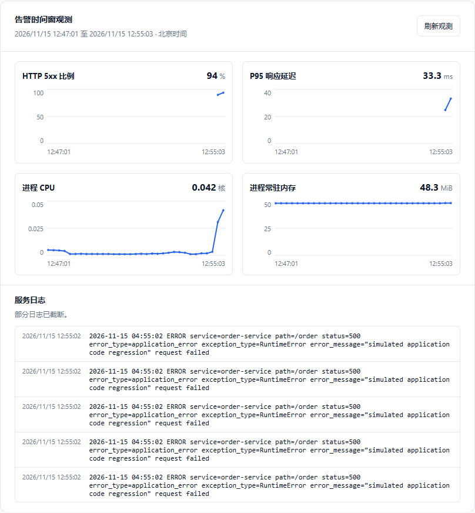

# 第一阶段部署与迁移验收

## 验收结论

第一阶段的开发和自动化验收已完成。最终候选后端全量运行退出 0：2818 passed、105 skipped、190 subtests passed，用时 2017.05 秒。前端 88 项测试及构建、两轮真实告警与业务恢复、MySQL 重启回读和 Windows 自动化审批验收均通过。真实历史保留的 38 项审计警告、真人审批及真实模型范围见下文。

范围来自 [开发路线图](INCIDENT_AGENT_DEVELOPMENT_PLAN_2026-11-11_10-49-02.md) 的阶段 1。操作说明见 [部署与复跑](STAGE1_DEPLOYMENT_GUIDE_2026-11-15_12-54-50.md)。未进入知识库、SSE 或 MCP 阶段。

## 候选与环境

基线为本地 main 的 `2bee6ee05f80df666e02eeecf70ecc4693651e1b`，叠加本阶段部署、回放、观测页面及兼容修复。通过 Git 归档生成独立源码，没有使用原工作区的真实 `.env`、data、虚拟环境或无关 Prompt、temp_test.py 改动。

最终 candidate-release 共 385 个文件，运行中的测试容器逐文件 SHA-256 比较为零差异。35 个前端文件与已通过测试和构建的候选完全相同。本阶段源文件与工作区比较时只归一化 LF/CRLF，结果为零差异。清单 release-manifest.json 的 SHA-256 为 `f39d9d1a799179b742724c99ff90d418a05ced86a98a9bae22508d6ef93f72be`。

本机使用 Windows、PowerShell、Python 3.12.14 和 Docker Desktop Linux 容器。最终后端回归连接真实 MySQL Community 8.4.13，datadir 为 5 GiB tmpfs，InnoDB buffer pool 为 128 MiB，关闭 Performance Schema。此环境验证 SQL 事务、锁与 Worker；数据库持久化重启另由 Compose 独立数据卷验证。

本地 main 比 origin/main 多 3 个 MySQL 提交。只读查询远端 main 得到 `f071ed5b336d7fcbe25af5197f88be18fe87c3a6`。本次续做没有提交、推送或触发 GitHub Actions，本地结果不代表远端 CI 已通过。

## 交付内容

| 能力 | 实现与边界 |
| --- | --- |
| 一次构建启动 | compose.yaml、deploy/Dockerfile 编排前端、API、一份 Monitor/Worker、迁移、MySQL、订单服务/PostgreSQL、Exporter、Prometheus、Loki、Alloy；固定版本、依赖锁和健康检查 |
| 持久化 | 复用现有 SQLAlchemy、MySQL Store 和 Alembic，首次升级到 0005_remediation_store；没有新增 Store 或迁移分支 |
| 无密钥调查 | demo_replay 走现有 Agent/Worker/工具链，读取真实指标和日志，明确标注演示回放及待核实根因；真实模型需显式配置 |
| 观测页面 | 服务与状态在分页前筛选；同窗 5xx、P95、进程 CPU、RSS 和日志；保留采样缺口及样本/无样本/失败状态；窄屏单列 |
| 容器通信 | 普通连接使用服务名；沿用 HTTPRecovery 固定 IP 校验，为订单实例保留可配置内部静态地址；仅发布两个回环端口 |
| 复跑脚本 | stage1_demo_acceptance.py 核对项目标签、源码 SHA、端口和健康基线，实际注入并恢复隔离故障，验证业务恢复和数据库重启回读 |
| Linux 兼容 | 三个只读脚本仅放行配置数据库的主机、解析地址和端口；SDK 平台信息在禁止进程边界前准备，边界内继续禁止外部进程 |

deploy/order-demo 的七个文件来自订单项目提交 `0e2f6f3220b9fb9f0baf8730de5ffaaac00d8c38`，归一化行尾后逐项完全相同。Dockerfile 只装配通信地址、监控账号初始化和 Loki 目录权限，未修改原订单项目。

## 自动化回归

| 检查 | 实际结果 | 原始记录 |
| --- | --- | --- |
| 固定 Python 测试依赖 | 安装与 pip check 通过；Windows 另建 venv | test-dependencies.log |
| 后端最终完整回归 | 2818 passed、105 skipped、190 subtests passed；2017.05 秒，退出 0 | backend-release-full.log、backend-release-junit.xml |
| 前端 | 6 个文件、88 项通过；TypeScript 和生产构建退出 0 | frontend-final.log |
| Windows W2/W3 与回放 | 40 passed，退出 0 | windows-remediation.log |
| Windows 进程、时间与数据库 | 21 passed、2 subtests passed，含全部 18 项进程测试 | windows-portability.log |
| Linux 修复专项 | 70 passed、1 项既有条件跳过，退出 0 | fixed-targeted-v2.log |
| Linux 平台与源码 | 7 passed、18 项 Windows 专用跳过、2 subtests passed | linux-portability.log |
| MySQL 锁与连接故障 | 34 passed，含三类断连/回执丢失各重复 10 次，退出 0 | lock-cleanup-stress.log |

最终 Linux 容器先从独立候选复制源码，再执行以下命令；环境变量指向专用测试 MySQL，并设置 INCIDENT_AGENT_CLEAN_ENV=1、ALERT_RULES_PATH=/workspace/deploy/order-demo/alerts.yml。

```text
python -B -m pytest tests -q -x --tb=short --disable-warnings -p no:cacheprovider -rs --durations=10 --basetemp=/tmp/stage1-release-full --junitxml=/tmp/stage1-release-junit.xml
```

前端在固定锁文件 npm ci 后执行 npm test 和 npm run build。部署从独立源码执行 docker compose up --build -d --wait --wait-timeout 180，随后用项目自带脚本完成故障与恢复验收。

最初磁盘临时库运行到约 4% 后主动停止，退出 137，未计为通过。第二轮 tmpfs 完整运行是 105 failed、2727 passed、87 skipped、4 errors、189 subtests passed，退出 1。其中 98 项失败来自 Docker 数据库解析地址误拦截，6 项来自 Windows 进程测试在 Linux 运行，1 个子测试受真实/模拟时钟偏差影响，4 个错误来自测试镜像缺少 Git。

修复地址校验后，独立冷启动 SDK 测试暴露首次平台信息读取会调用 uname，已在禁止进程边界前准备。时间测试与 Runtime 共用注入时钟，保留 15 秒有效期和原断言。Windows 进程类明确平台范围，并在 Windows 全部通过。验证镜像补装 Git，生产依赖不变。各失败轮次保留原始日志，最终完整回归从头执行。

随后一轮完整回归为 1 failed、2817 passed、105 skipped、190 subtests passed，用时 2075.78 秒。唯一失败是 test_disconnected_lock_session_fails_closed_and_is_not_reused 在 KILL 后立即断言锁已释放。生产代码已按预期报错并丢弃断连会话。MySQL 官方说明 KILL 返回时不等待线程清理完成，锁在会话终止时释放，因此测试的即时断言存在竞态。[KILL 说明](https://dev.mysql.com/doc/refman/8.4/en/kill.html) · [用户级锁说明](https://dev.mysql.com/doc/refman/8.4/en/locking-functions.html)

该轮的 105 项条件跳过中，70 项缺少操作者私有封存制品，35 项限定 Windows。35 项 Windows 用例已分别纳入本次 40 项和 21 项的 Windows 专项，实际执行通过。

测试现以最多 5 秒的观察确认服务端实际释放锁，保留报错、连接身份不复用和实际重新取得锁的断言。该规则也用于丢失锁回执后的断连清理观察。三类故障各重复 10 次加原有 4 项，共 34 项通过。与上轮候选相比仅 tests/test_remediation_mysql.py 改变，部署及全部生产 Python 源码相同。

## 两轮真实告警与业务恢复

两轮均从健康订单开始，实际启用代码回归并访问 /order，由原 Prometheus 规则触发 HighHttp5xxRate，唯一 Monitor/Worker 建立调查。模型响应来自回放，指标、日志和业务检查来自实际服务。

| 结果 | 第一轮 | 最终页面轮次 |
| --- | --- | --- |
| Incident | inc-54e4c5a9 | inc-f9f5d560 |
| Session | ses-a2504913f1ee481eb0dd6483c1675dae | ses-84f1ef1e91e041cb95e54d94ef476548 |
| 工具执行 | 3 | 3 |
| 捕获的最高 5xx 比例 | 1.0 | 0.9399603205130341 |
| 应用异常日志 | 50 | 50 |
| 5xx/P95/CPU/RSS 样本数 | 2/2/8/8 | 2/2/33/33 |
| 解除故障后的业务检查 | HTTP 200，verified | HTTP 200，verified |
| MySQL 重启后比较 | Incident、Session 完全相同 | Incident、Session 完全相同 |
| 最终故障开关 | false | false |

最终运行时镜像重建后，/readyz 成功，两轮 Session 均为 COMPLETED、业务恢复均为 verified，/order 返回有效订单。恢复判定使用独立业务结果，未仅依赖 /health。

Chrome 实际检查服务筛选、四张曲线与日志。1440 和 390 像素窗口均可用，窄屏观测区宽 358 像素，JavaScript 运行错误为 0。



## Windows 自动化审批与制品恢复

沿用 W3 入口及原授权/制品校验，在 Chrome 使用 requester、approver、executor 测试身份。Requester 越权批准均 HTTP 403。

- 批准轮次生成 rem-869667f4819a4ba5b4388cd9d2a2ee83，执行 HTTP 200，库存从 HTTP 500 恢复至 200；实际 release_id=A，提案摘要绑定一致，独立业务验证 passed。
- 拒绝轮次生成 rem-caac1e313cdf4eb38e4cd4125ef64926，后续执行 HTTP 409，业务保留该轮未恢复状态；结束时关闭本轮自有进程。

这些记录属于自动化身份验收，真人审批仍待实际操作者产生记录。两轮 STOP 文件存在，临时 operators.json 已删除。

## 历史兼容与并发恢复

真实历史源先捕获一致副本，通过 db.import_legacy 导入全新 schema：Incident、映射和归档共 26 行，Runtime 共 1416 行。重复导入分别为 26 和 1416 unchanged，新增均为 0；源目标摘要差异均为 0。导入前后原件哈希不变，一致副本的哈希也保持不变。

严格校验 consistent=false，保留 16 项 legacy_checkpoint_event_identity_unavailable 和 22 项 checkpoint_result_display_count_mismatch。没有补造历史事件或更改展示计数来制造通过。真实旧 Remediation JSON 不存在，兼容由现有合成回归覆盖。迁移先前结果见 [MySQL 双版本验收](MYSQL_DUAL_VERSION_ACCEPTANCE_2026-11-15_12-20-55.md)。

真实历史源没有可用人工请求/消息，另以迁移前 SQLite 实现生成隔离合成流程，导入 1 项 HumanRequest、3 项 HumanMessage，保留命令大小写、尾部空格身份和预算；该流程严格一致性为 true，与真实历史分别记录。

在新 MySQL schema 中，6 次并发提交相同回答只应用 1 次；2 个独立进程领取任务仅 1 个获得有效 claim。持有者退出码 97 异常终止，租约到期后恢复为 QUEUED，再领取为 RUNNING，fence 递增。结果见 human-recovery.log。

## 收尾与证据

最终 JUnit 共记录 2923 项主测试，失败和错误均为 0。再次核对 385 个候选文件与工作区相关源码，归一化行尾后为零差异，清单 SHA-256 不变。

已保存两轮业务结果、截图、Compose 日志并清理隔离演示项目。真实历史副本的四个数据文件及导入它们的临时 MySQL 容器已删除，保留摘要；原始历史未修改。

最终清理确认本轮测试容器为 0，临时网络和演示数据卷已删除。原有 networklab-exp4-mysql、postgres-exporter、order-db 保持运行；宿主机 MySQL 和原有 IPv6 Vue 服务未停止。W3 实验进程已退出，临时凭据已删除。构建镜像、候选源码、日志和合成夹具保留供复跑，结果见 cleanup-final.json。

原始目录为 `D:\codex use\2026-11-15\mysql\stage1-validation-20261115-123559`，保留候选、清单、日志、JUnit 和验证脚本，未加入 Git。工作区原有 Prompt、临时脚本、旧文档移动和历史测试目录保持原状，本次续做修改未暂存或提交。

未验证真实付费模型、真人审批、生产部署和远端 CI。干净源码缺少操作者私有封存制品的测试按既有条件跳过，没有以夹具替代封存结果。
