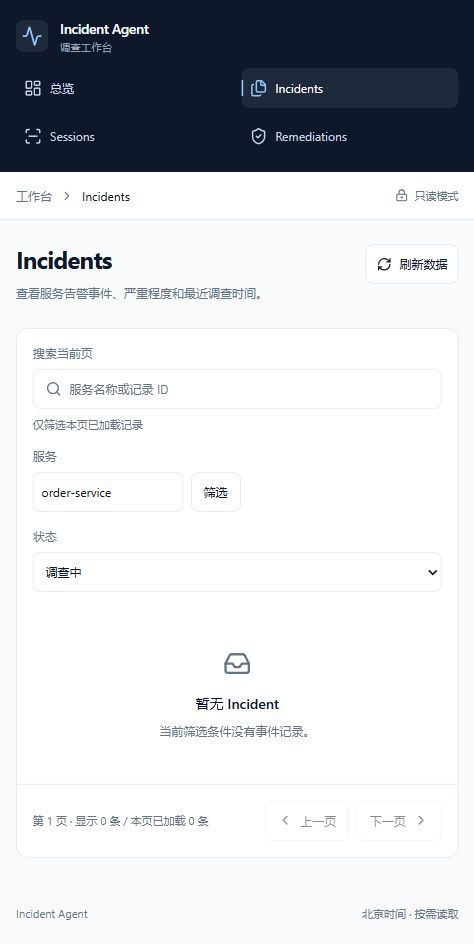
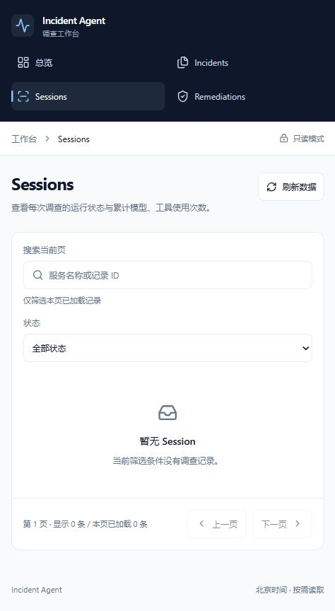

# 第一阶段真实启动与模型联调验收记录

## 结论与停止边界

**真实隔离启动通过；真实付费模型联调未执行，验收在首次付费前停止。** 本轮未能验证包含工具定义和 Responses 协议开销的输入 token 上界，依照本轮授权的停止条件封闭发送通道。没有用回放、Mock 或状态修改替代真实模型结果。

实验 ID：`incident-stage1-live-20261115-152131`。Incident、Session、Attempt 均未创建，实际官方模型请求 **0** 次，Agent 工具执行 **0** 次（自动版本探针也是 0）。没有注入故障、审批或执行 Remediation，没有进入第二阶段，也没有提交或推送。

## 源码与实际入口

- 目标、实际归档、本地 HEAD、实时核对的远端 `origin/main` 均为 `8e2bc425d304181e9cb95609db58b53e50820a8b`；远端为 `https://github.com/yuj1ng1/incident-agent.git`。默认 schannel 查询曾失败，随后仅对查询使用 OpenSSL TLS 后端，保留证书校验并成功读取远端 SHA。
- 从该提交执行 Git 归档，在 Git 外的独立源码目录构建。运行镜像中 100 个 Python/配置/依赖文件与归档逐项 SHA-256 相同，差异为 0。没有带入工作区修改过的 Prompt、temp_test.py、真实 `.env`、data 或虚拟环境。
- 原工作区 `prompts/agent_prompt.py`、`temp_test.py` 以及全部原有未跟踪项保留；两个已修改文件前后哈希一致，暂存区仍为空。仓库只新增本报告和脱敏验收附件，没有修改业务代码、全局预算、告警阈值或依赖。
- 启动入口为归档源码的 `compose.yaml`，显式启动 mysql、migrate、order-db、postgres-exporter、order-service、prometheus、loki、alloy、api、frontend。**没有运行 `main.py`，没有启动 monitor、Scheduler 或真实 Worker，也没有运行固定回放验收入口。**
- 实际辅助入口位于私有目录 `harness/`：`baseline.py` 采集、`finalize_baseline.py` 校验、`verify_tokenizer.py`、`test_offline_guard.py`、`transport_gate_probe.py`、`restart_readonly.py`、`cleanup_owned.py`。SDK 检查复用了目标源码 Agent、ModelClient、ToolManager 的 schema；它只在离线传输边界拒绝请求，没有创建替代 Agent，也没有向 Session 注入任何结果。
- 已阅读现有 IncidentMonitor → Manager → Worker → Store 调用链及 API、ServiceRegistry、Alembic。因付费门槛未满足，这条完整调查链本轮未运行。

冻结参数摘要：`d9c1f203229403cbb05effe63b73c91794aeb41b7ceca6b85abc4e1da71226bf`。冻结记录包括目标 SHA、源码清单、实际 SDK、官方模型别名、token 验证证据、守卫文件和限额。Runtime 原计划隔离限制为 1 Attempt / 7 模型请求 / 13 工具 / 0 resume / 900 秒 / SDK 60 秒 / 0 重试；这些参数**未实例化为真实调查 Runtime**，不能记为 Runtime 验收通过。

## 环境与真实启动结果

| 项目 | 本轮观测 |
| --- | --- |
| Docker | Desktop Linux 容器，引擎 29.8.1 |
| 平台运行时 | Python 3.12.14；OpenAI SDK 3.14.0；httpx2 2.13.0 |
| 持久化 | 平台 MySQL 8.4.13；SQLAlchemy 2.0.54；Alembic 1.20.1；迁移到 `0005_remediation_store` |
| 订单依赖 | 独立 PostgreSQL 17.11，区别于平台 MySQL；未连接宿主机 MySQL 或原订单库 |
| 观测组件 | Prometheus 3.15.0、Loki 3.7.0、Alloy 1.20.1、postgres-exporter 0.20.1 |
| 前端 | 按锁文件实际构建，nginx 1.28.3 镜像；HTTP 页面、API `/readyz` 可用 |
| 回环端口 | 工作台 `127.0.0.1:18088`、订单 `127.0.0.1:18081`，启动前已核对空闲 |
| 网络 | 独立 `172.30.177.0/24`；订单固定地址 `172.30.177.10`，与现有 Docker 子网无重叠 |

10 个本轮容器创建成功，其中迁移容器退出 0，其余服务启动。Prometheus 的订单、PostgreSQL Exporter、自监控三个 target 均为 up；`pg_up=1`。实际 Loki 查询取得 30 条订单成功日志。Alloy 自身回环管理端点返回 `Alloy is ready.`，同时 Loki 入库证实日志链路。

开始与收尾共 **54 次** `/order` 请求均返回 HTTP 200、有效 order 对象、正确 service/dependency；流量按至少 0.55 秒的发起间隔限速，未超过 2 次/秒。`/version` 为订单源码 `0e2f6f3220b9fb9f0baf8730de5ffaaac00d8c38`，故障标志始终为 false。没有修改或降低既有告警规则；本轮 Prometheus 告警为空。

准备辅助检查曾遇到 Alloy 管理端口跨容器不可访问、Windows 清单路径分隔符导致的比较失败，以及本地 Transformers/tokenizers 版本不匹配。前两项改用容器内回环探测与统一清单键后核实；模板检查改为直接渲染官方 Jinja 模板。初始失败未计为通过，没有更改项目或全局依赖来掩盖这些结果。原始辅助脚本和问题记录保留。

## 输入 token 上界为何未通过

已在执行前读取并保存[官方计费规则](https://api-docs.deepseek.com/quick_start/pricing/)、[Responses 参数](https://api-docs.deepseek.com/api/create-response/)、[协议兼容说明](https://api-docs.deepseek.com/guides/responses_api/)和[离线 token 文档](https://api-docs.deepseek.com/quick_start/token_usage/)。当前文档将 `deepseek-flash` 指向 DeepSeek-V4.1-Flash-1017；本轮没有模型响应，因此实际服务端返回版本未知。

从 token 文档实际链接下载的文件是 `deepseek_v4_tokenizer.zip`，SHA-256 为 `e7310d1dafe0a86d8a5629fe78a7c763760f651db9b8682718a1781dcd6fe495`。包内 `tokenizer_config.json` 的聊天模板只引用 `messages`、`bos_token`、`add_generation_prompt`，没有读取 tools。离线渲染加入与不加入工具 schema 的结果完全相同，工具名、描述和参数均未进入渲染输入。这项观察可由[模板检查结果](assets/stage1-live-20261115-152131/tokenizer-verification.json)复核。

这说明直接套用该示例会漏算工具定义。分别编码文本片段或完整 JSON 也不能直接证明服务端序列化和协议开销的上界。本轮没有核实能覆盖当前模型、instructions、工具定义、历史、function_call/output 及协议开销的完整计数入口或可证明保守上界，所以没有发送试探性请求来获取 usage。结论是“本轮上界未验证”，并非断言所有官方计数方式都不存在。

## 守卫、账本与 SDK 检查

安全账本是 Git 外独立 SQLite 文件 `private/experiment-ledger.sqlite3`，只用于本轮授权防重复消费，没有替代项目 MySQL Store。创建采用独占文件创建，领取采用原子条件更新；终态为 `STOPPED`，原因为 `whole_responses_input_token_bound_unverified`。MySQL 重启后，已在另一个进程再次打开账本，确认本轮领取仍被拒绝；资源清理前后账本哈希一致。

离线守卫 **12 项检查通过**：请求/工具次数、输入/输出上限、累计费用、时长、供应商模型固定、禁止原生收费工具、错误后封闭、重启重复领取等。计费分支使用明确标注的合成 token 上界，没有将其视为真实模型计数证明；中断预留检查是离线状态检查，没有实际杀死业务进程或制造故障。

使用镜像中实际 OpenAI SDK 和目标 ModelClient 捕获一次**离线**序列化请求：原始 JSON 缺少 `max_output_tokens`；隔离传输检查将其设置为 8192 后再次解析实际 Request 内容，并执行拒绝守卫。SDK 重试为 0，只进入离线传输边界 1 次；未创建可转发官方 HTTP 的底层传输，也没有装载真实密钥。SDK 表层的 `APIConnectionError` 来自本地守卫拒绝，不是一次真实官方连接失败。没有构造成功响应，也没有生成 call_id 或 function_call_output。

本地 `.env` 的 `DEEPSEEK_API_KEY` 已确认存在，进程环境中未配置。只报告存在性，未打印、复制到隔离环境或保存认证头。首次付费门槛未满足，所以没有向持续进程挂载密钥。

## 计价、预留与实际消耗

采用[官方较高时段价格](https://api-docs.deepseek.com/quick_start/pricing/)，并按所有输入未命中缓存计算：输入 US$0.30 / 百万 tokens，输出 US$1.20 / 百万 tokens。8192 的官方输出上限包括推理和可见输出。

| 项目 | 结果与含义 |
| --- | --- |
| 每次理论最坏费用 | 若 65536 输入与 8192 输出上界均已证明，则为 US$0.0294912 |
| 七次理论总额 | 同一前提下为 US$0.2064384，低于 US$1；**这是条件性预算计算** |
| 本轮费用预留 | US$0，缺少输入上界时未允许预留和发送 |
| 真实官方请求 | 0，包括结果不确定的已发送请求也为 0 |
| usage | 未产生真实模型响应，未知/不可用 |
| 实际扣款/账单 | 未查询到账单，未知；不能把理论上界或预留额写成扣款 |

没有切换供应商或模型，没有原生搜索、文件解析、图片或其他收费能力。没有因剩余额度而重试、resume、reopen 或新建实验。

## 业务状态、数据库重启与浏览器

没有故障注入，因此本轮不能证明故障触发、真实根因调查、异常退出恢复或 Agent 自主修复。收尾脚本在 finally 中核对本轮订单容器的故障标志为 false，并检查有效 `/order` 业务响应；没有仅用 `/health` 宣称业务恢复。没有 Incident，原有独立业务恢复状态无本轮记录，不存在可以判为 verified 的恢复流程。

发送通道封闭后，先停止 API/前端，再实际重启本轮 MySQL；随后用一次性只读入口、`RuntimeStore(read_only=True)` 与 SELECT 回读。迁移版本及各表行数/内容哈希前后一致，Incident、Session、Checkpoint、事件均为 0。**这只证明 schema 与空记录集的重启回读，未验证真实调查预算、Checkpoint、事件及工具输出的持久化。** 重启后没有恢复付费执行器。

浏览器实际打开工作台、订单服务与调查中状态筛选、Sessions 页面，观察到 0 条记录。截图展示真实空状态，没有填充固定内容。因为没有 Incident，详情页同窗 5xx/P95/CPU/RSS、日志、模型结论及引用有效性均未验证。截图和 API 空列表不代表真实调查验收通过。

| 验收维度 | 本轮判定 |
| --- | --- |
| 官方 Responses 接口协议可用性 | 未验证，没有真实请求 |
| Runtime 调查生命周期与预算 | 未验证，未创建 Session/Attempt |
| 模型证据引用有效性 | 未验证，没有模型结论或引用 |
| 根因得到证据支持 | 未验证，没有模型结论；验收控制器也未注入故障 |
| 平台及观测服务真实启动 | 通过上述启动、真实业务与采集检查 |
| 异常退出后的故障恢复能力 | 未验证，本轮未开启故障 |
| 真人审批/修复执行 | 未执行，没有使用自动化身份冒充真人 |

## 资源收尾与原有数据

清理前逐项核对 Compose project/service 标签、容器 ID、网络成员、数据卷归属及外部挂载，随后仅删除本轮 **10 个容器、1 个网络、6 个数据卷**。最终本轮容器、网络、卷均为 0，没有遗留付费执行器或故障容器。没有创建临时真实凭据。保留 7 个本轮命名的构建镜像以便核对源码，不包含真实 API Key。

原有 6 个 Docker 容器的 ID、运行/退出状态、StartedAt 和退出码前后相同；原有网络、卷保留。原有 networklab-exp4-mysql、postgres-exporter、order-db 持续运行，宿主机 MySQL80 清理前后均为 Running。没有操作原订单数据、宿主机库或历史记录。

此前报告中的 38 项历史审计警告未修改、未消除，本轮没有重新导入或重新审计真实历史，不能把历史验证结果计入本轮。没有重复全量回归：生产源码没有改动，本轮新增辅助守卫执行了上述匹配检查。

## 证据与可核对摘要

原始资料保存在 Git 外受保护目录：`D:\codex use\2026-11-15\stage1-live-20261115-152131`，其中 `private/` 保存源码清单、官方页面、tokenizer 包、离线请求体、账本、数据库快照、监控响应和日志，`harness/` 保存实际入口。根目录 ACL 关闭继承，仅授予当前用户及 SYSTEM；没有保存认证头。原始源码位于 `source/`，目标归档为 `target.tar`。本轮没有真实模型响应体、安全响应头、usage 或 call_id，这些资料不存在，不补造。

脱敏摘要及截图位于[本轮附件目录](assets/stage1-live-20261115-152131/final-summary.json)，原始证据的逐文件摘要见[哈希清单](assets/stage1-live-20261115-152131/evidence-sha256.json)。清单 SHA-256：`760d81d6f6fdb2816ad2c04f670503dc81e4eb7e012a6e4a6f8c1bcbe294fa34`。

| 证据 | SHA-256 |
| --- | --- |
| 冻结参数 | `d9c1f203229403cbb05effe63b73c91794aeb41b7ceca6b85abc4e1da71226bf` |
| 安全账本 | `ca02be2d9664767bfaed54ab4ea5d07523986863049631f5bbeada5e67d55499` |
| 官方计费页面 | `5126b5f69e78f6dacb0a8bfc91e0cf0b705416b0b918b12e1f45f66b122e7741` |
| 官方 Responses 参数页面 | `9922b794675267bd38f430aa27ed471501fdd9a2c5aad6e58e968512362a4f06` |

本轮结果是**付费前停止**。继续真实模型验收的技术前提是取得并核实完整 Responses 输入的可靠 token 上界；本轮不会自动开启后续付费实验。
