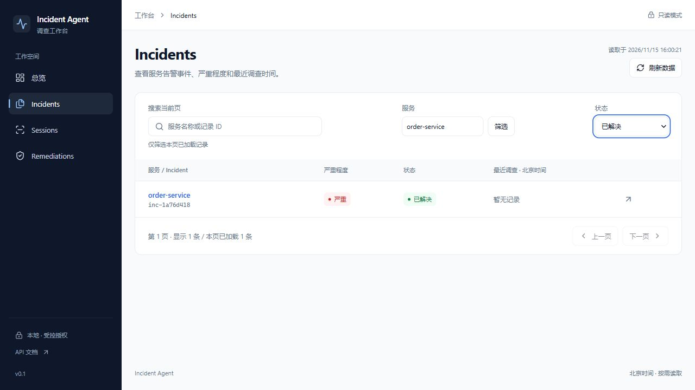
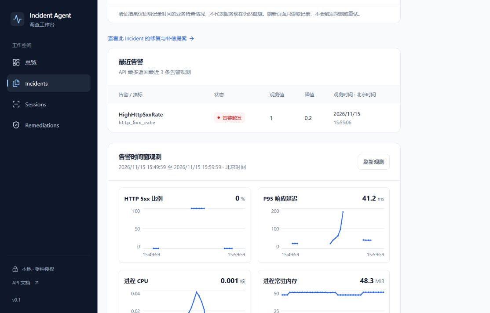

# 第一阶段真实模型联调验收：已停止，完整调查未通过

本轮确实向官方 DeepSeek 发出了 **1 次真实模型请求**。官方返回 HTTP 200、`status=completed`、usage 和 5 个 function_call，但隔离取证入口错误重建已读取的响应，SDK 抛出 `APIConnectionError`，底层为 `DecodingError`。调查随即停止，Session 保持 **EXHAUSTED / model_incomplete**；没有执行这 5 个模型工具调用，没有模型最终结论，也没有把状态改成 COMPLETED。

用户最后选择“保持停止，交付本轮报告”。错误后未重试、未 resume/reopen、未新建实验。故障已由测试控制器关闭，独立业务恢复验证通过；MySQL 重启回读通过。本轮临时容器、网络和数据卷已清理。实际调查发生于 **2026-11-15**，清理和本报告交付完成于 **2026-11-16**；下列人工阅读时间均为北京时间，原始记录保留 UTC。

## 源码、入口和环境

| 项目 | 本轮事实 |
| --- | --- |
| 目标 / 实际 SHA | `8e2bc425d304181e9cb95609db58b53e50820a8b`，二者一致 |
| 原目录 | `D:\Incident Agent`，main；保留原有 `prompts/agent_prompt.py`、`temp_test.py` 修改及全部原有未跟踪文件，两个原修改文件的 SHA-256 未变化，暂存区为空 |
| 远端 | `origin` 为 `https://github.com/yuj1ng1/incident-agent.git`；11 月 15 日只读核对 main 与目标一致；11 月 16 日再次查询遭遇 TLS unexpected EOF，未将当日远端状态写成已确认 |
| 独立源码 | Git archive 生成 `D:\codex use\2026-11-15\stage1-live-20261115-154614\source`，容器内比对的 100 个后端源码/依赖/迁移文件无差异；没有复制原 `.env`、原数据库或工作区 Prompt 修改 |
| 实验 / Compose 项目 | `incident-stage1-live-20261115-154614` |
| 实际启动入口 | 宿主 `harness/run_live_experiment.py`；容器 `python -B /evidence/harness/live_worker.py`，通过 Compose 一次性 api 服务容器运行 |
| 实际调用链 | `IncidentMonitor.process_alerts_once → InvestigationManager → Worker.run_once → Agent → ModelClient → 受控官方 HTTP Transport`，Store、ServiceRegistry、ToolManager、API 和 Alembic 均复用现有实现 |
| 源码改动 | 无生产代码改动；仅 Git 外新增隔离启动器、账本守卫、取证/恢复/回读脚本，以及本报告和脱敏附件；没有新增生产接口、Store、数据模型或第三方依赖 |
| 版本 | Docker Engine 29.8.1；运行 Python 3.12.14；openai 3.14.0、httpx2 2.13.0；SQLAlchemy 2.0.54、Alembic 1.20.1、PyMySQL 1.2.4、FastAPI 0.140.13、Uvicorn 0.54.0 |
| 数据角色 | 平台 MySQL 实测 8.4.13，迁移 `0005_remediation_store`；订单 PostgreSQL 镜像固定 17.11，二者不混用 |
| 其余镜像版本 | Prometheus 3.15.0、Loki 3.7.0、Alloy 1.20.1、Exporter 0.20.1、前端 Nginx 1.28.3；此处为部署源码/镜像固定版本，非清理后重新运行版本命令的结果 |
| 模型 | 原项目 `config.py` 中的 `deepseek-flash`，官方 `https://api.deepseek.com/responses`；响应也返回该别名，未独立核实实际服务端修订版本 |
| 冻结参数 SHA-256 | `2d28e8f6c13418b5832c60af9a396edcdd5908ae8128b6e482dd77b46b421483` |

未运行持续监控的原样 `main.py`，也未使用 `stage1_demo_acceptance.py` 的固定回放话术判定模型成功。受控入口的结果不能外推为原样 main.py 已通过。准备前已阅读当前 AGENTS.md、[阶段一验收](STAGE1_ACCEPTANCE_2026-11-15_14-50-13.md) 和 [部署指南](STAGE1_DEPLOYMENT_GUIDE_2026-11-21_10-31-39.md)。

## 隔离、守卫和约束偏差

新项目仅映射回环端口 `127.0.0.1:18088`、`127.0.0.1:18081`，子网 `172.30.178.0/24`，订单实例 `172.30.178.10`。启动前检查端口、网络重叠和资源标签；清理前再次检查项目、服务、镜像 ID、网络成员和数据卷归属。没有启动该项目的持续 Monitor 服务。模型模式在常驻服务中保持 disabled，仅单份一次性 Worker 持有真实客户端。

从可信本地配置 `D:\Incident Agent\.env` 检查到 DeepSeek 凭据和 GitHub 凭据存在。凭据仅经 Worker 标准输入进入内存，没有写入 Compose 环境、参数、源码或证据文件；未打印密钥、完整环境、完整含凭据 Compose 配置或认证头。官方主机的独立 TLS 探测验证了主机名与证书链。

执行参数为 1 Incident、1 Session、1 Attempt，最多 7 模型请求、13 工具执行（包含自动版本探针），输出上限 8192（含推理），SDK 60 秒、总时限 900 秒，SDK/HTTP/Runtime 重试均为 0，resume 上限 0。隔离 HTTP 入口确实改写并重新解析发送体，保存的真实请求具有 `max_output_tokens=8192`，且只允许 function 工具；没有启用官方原生搜索、文件解析等额外付费能力。未修改全局生产预算。

**输入 token 与费用约束存在执行解释偏差。** 后续“不用考虑此次 token 的花费”被入口解释为同时取消 US$1 费用上限和 65536 输入 token 上限，冻结配置中两者均为 null。本轮没有建立可靠的发送前输入 token 上界，也没有预留最坏货币费用。因而不能宣称满足原先这两项发送前守卫要求；事后 usage 为 10117 也不能替代发送前证明。本报告保留该偏差，不把字符估算或请求后 usage 当作事前控费。

发送前的 Python 账本守卫使用排他文件创建、SQLite 持久化与事务预占请求/工具次数；发送失败或结果不确定仍计数，错误后封闭。离线专项最终 **12 项通过**，覆盖第 8 次模型请求阻断、工具上限含探针、输出上限、模型/参数变更、原生工具禁用、时限、停止标记、错误后发送阻断、不可重复消费及不确定请求计数。初次离线运行有 1 项连接未关闭错误，已在付费前局部修正并重跑通过。没有重复长全量回归。

本轮 finally 恢复路径实际执行并验证。独立 watchdog 已布置，但**进程强制异常退出时 watchdog 是否成功恢复没有做故障退出演练**，这项前置验证未完成，不能写成通过。

## 真实故障和单次官方响应

| 时间 / 对象 | 记录 |
| --- | --- |
| 健康基线 | 24 次有效 `/order`，真实 Prometheus 订单/Exporter/自身 target up、`pg_up=1`；Loki 获得 24 条基线日志；Incident、Session 和真实模型执行器均为 0 |
| 故障开始 | 11 月 15 日 15:54:21，仅本轮订单容器开启 `SIMULATE_CODE_REGRESSION` |
| 真实告警 | 原有 `HighHttp5xxRate`，阈值 0.2、1 分钟至少 20 请求、持续 10 秒；未改规则，实际值 1.0 |
| Incident | `inc-1a76d418` |
| Session | `ses-681e26aa31ac40e4b50ef49122123b77` |
| 首次发送预占 | 11 月 15 日 15:55:08；仅一次官方模型 HTTP 请求 |
| 官方结果 | HTTP 200、`completed`、error=null，响应 ID `3b491c9f-f3e9-41be-b585-7f0c2be25443`；收到 5 个工具调用，无模型最终回答 |
| 实际消耗计数 | 1 Attempt、1 模型请求、1 工具执行、0 retry、0 resume、0 reopen |
| 唯一已执行工具 | 原有自动 `get_running_version(service=order-service)`，真实运行版本 `0e2f6f3220b9fb9f0baf8730de5ffaaac00d8c38`，故障时运行标志为 true |
| 调查终态 | `EXHAUSTED`，`last_error_category=APIConnectionError`，结果 `model_incomplete`，next_retry_at=null |
| 账本终态 | CLOSED，原因 DecodingError；该模型请求标记 FAILED_OR_UNCERTAIN，已计入次数 |

5 个模型调用分别为：查询 `http_5xx_rate`、查询 `http_request_rate`、查询 07:53–07:56 UTC 的订单日志、检查服务健康、查询依赖。call_id 和完整参数见 [官方响应脱敏摘要](assets/stage1-live-20261115-154614/official-response-summary.json)。**这 5 个调用均未执行**，没有生成或补造 function_call_output，没有把私有捕获响应重新塞回 Session。唯一版本探针的 call_id、原始参数和真实结果见 [工具证据](assets/stage1-live-20261115-154614/tool-01.json)。

错误位于我编写的 Git 外取证入口：读取响应后，用保留原响应头的已解码内容重新构造 HTTP 响应。离线用本轮保存的真实 JSON 响应体和合成 gzip 传输复现了相同异常；改为返回同一个已读取响应对象后，SDK 可离线解析 completed、5 个 function_call 和相同 usage。该修正保存在另一个隔离文件 `harness/live_worker_fixed.py`，原冻结入口未修改，**修正后没有再次真实请求**。原始安全响应头白名单没有保存 content-encoding，因此实际线上编码未知，压缩重解码原因由代码路径和离线复现支持，不能断言当时一定是 gzip。此处不应把 SDK 的连接错误标签解释成官方接口断连。

## usage、价格和费用口径

执行前核对了官方 [计价规则](https://api-docs.deepseek.com/quick_start/pricing/) 和 [Responses 参数](https://api-docs.deepseek.com/api/create-response/)，交付时再次只读核对。官方参数说明 `max_output_tokens` 包含可见与推理 token。价格按每百万 token 计，Flash 较高时段输入未命中 US$0.30、输出 US$1.20。本轮请求只使用函数工具。

| 官方响应 usage | 数值 |
| --- | ---: |
| input_tokens | 10117 |
| cached_tokens | 0 |
| output_tokens（已含推理） | 535 |
| reasoning_tokens（输出的子集） | 279 |
| total_tokens | 10652 |

按较高时段且全部输入未命中计算：`10117 × 0.30 / 1000000 + 535 × 1.20 / 1000000 = US$0.0036771`。这是**基于已返回 usage 的保守价格估算**，不是发送前预留，不是实际扣款，也不是包含未知项目的账单证明。没有另加 279 个推理 token 重复计价。本轮货币预留为“未实施”；实际账单/扣款**未知**，未以余额差或价格估算冒充账单。计价来源支持的估算与账户实际记账分开记录于 [实验摘要](assets/stage1-live-20261115-154614/summary.json)。

## 页面和证据判断

浏览器实际核对了 order-service 与“已解决”状态筛选，结果仅本轮 Incident；详情展示告警、同窗四项指标、真实日志、调查失败和独立业务恢复。控制台采集未见浏览器错误。最终采样窗口为 11 月 15 日 **15:49:59–15:59:59**、步长 15 秒。

| 指标 | 查询状态 | 返回样本数 | 本窗样本最大值 |
| --- | --- | ---: | ---: |
| http_5xx_rate | ok | 13 | 1.0 |
| http_latency_p95_seconds | ok | 13 | 0.18249999999999986 |
| process_cpu_cores | ok | 41 | 0.03873008946105171 |
| process_resident_memory_bytes | ok | 41 | 50663424.0 |

P95 单位为秒，CPU 为核数，RSS 为字节。日志返回 50 条且 truncated=true，不能据此代表全部日志。曲线有采样缺口，未补零。上述指标和日志来自真实服务及 API 展示，属于验收侧观测，**并非未执行的模型工具调用取得的证据**。原有版本探针获得的故障标志是实际工具观测；验收控制器另知的故障原因不充当模型结论。

页面存在一个限制：API 的只读 Manager 使用生产默认预算，显示分母 3 Attempts / 21 模型 / 39 工具 / 8 resumes / 3600 秒；实际执行器冻结上限是 1 / 7 / 13 / 0 / 900 秒。页面已用次数与持久化一致，但分母不反映本轮隔离配置，不能用页面分母证明隔离限额。未为此次验收修改生产 API。

| 判断项 | 结论 |
| --- | --- |
| 官方接口协议 | **部分通过**：真实官方 HTTP 200、响应 JSON/usage/function_call 已保存；离线 SDK 解析可用。真实 SDK → Runtime 交付失败，多轮协议未验证 |
| Runtime | **失败路径通过**：真实告警建立唯一调查，预占计数、探针、错误终止、无重试、Checkpoint/事件持久化与回读正确；成功循环和 COMPLETED 路径未验证 |
| 证据引用 | 探针证据和 observation_id 可回溯；模型没有最终回答，**引用有效性未验证** |
| 模型根因 | **未验证**：没有模型最终结论或后续工具结果，不能以注入原因、Incident resolved 或接口 completed 代替 |
| 完整真实模型联调 | **未通过，按用户决定保持停止** |

完整 [Incident 页面](assets/stage1-live-20261115-154614/incident-detail.jpg)、[Session 失败页面](assets/stage1-live-20261115-154614/session-failed.jpg) 和 [页面 JSON](assets/stage1-live-20261115-154614/session.json) 均保留；Session 页中生产默认分母的限制见上文。

## 恢复、数据库回读和清理

11 月 15 日 15:55:20，先封闭模型发送通道、结束付费执行器，再由控制器 finally 关闭故障并重建本轮订单容器；故障持续 **59.50 秒**。本轮 `/order` 流量共 **136 次**：基线 24、故障 80、恢复阶段 26（含既有独立业务验证器 1 次）、收尾复核 6 次。流量按至少 0.55 秒节流，不超过每秒 2 次；故障阶段 80 次均为实际 application_error/HTTP 500，其余业务样本为有效订单响应。

恢复观测入口没有构造 ModelClient 或调查 Worker。11 月 15 日 15:57:59，告警解除，既有独立 `order_read_query` 验证首次成功：HTTP 200、dependency=order-db、service=order-service、order 非空对象四项均匹配，Incident 变为 resolved，`recovery_verification=verified`。收尾 6 个有效业务响应及版本接口再次确认故障标志 false。这是**测试控制器恢复 + 既有独立业务验证**，没有 Agent 自主修复。没有审批或执行 Remediation，没有把自动化身份当作真人批准。

11 月 15 日 16:02:47，停 API/前端后重启本轮 MySQL。只读入口前后完整表内容快照相等：1 Incident、1 Session、4 个保留 Checkpoint、15 个事件、1 个真实工具记录，Attempt/模型/工具仍为 1/1/1，EXHAUSTED 与业务 verified 均保留。新进程重新 claim 实验账本被拒绝，账本哈希不变；未恢复付费调查。数据库完整行与输出保存在 Git 外，脱敏 [回读摘要](assets/stage1-live-20261115-154614/restart-summary.json) 可核对。清理前已保留这些数据，删除临时卷不表示未取证。

收尾跨日续接时发现 Docker 引擎不可访问，上一清理进程没有完成结果，停机原因未知。11 月 16 日 13:54 恢复引擎访问，确认本轮 10 个容器全部停止、故障环境值 false、无付费 Worker、账本 CLOSED 后才清理。该次引擎启动使 3 个原有运行型容器按既有行为恢复运行，StartedAt 与前一天不同；因此**不能宣称全时段原有容器运行状态完全未变化**。没有对其单独执行 stop、recreate、删除或配置修改。

11 月 16 日 13:56，核对项目标签、服务和镜像身份后，移除本轮 **10 容器、1 网络、6 数据卷**，本项目残留这三类资源均为 0；清理操作前后 6 个外部容器状态完全一致，原有卷/网络保留，宿主 MySQL80 仍 Running，模型账本哈希保持不变。保留 7 个本轮构建镜像作为可核对缓存，未广泛清理 Docker 镜像。无真实凭据临时文件可删除；Git 外源码、脚本和证据按验收要求保留。[清理证据](assets/stage1-live-20261115-154614/cleanup-result.json) 与 [跨日环境变化](assets/stage1-live-20261115-154614/cleanup-resumption.json) 分别保存。

自动审批拒绝删除离线守卫测试目录 `C:\Users\zp1222\AppData\Local\Temp\tmpf59drzkc`，只返回“blocked by policy”。该目录仅含合成测试账本，已保留，没有换方式绕过删除。这项限制不影响上述已完成的本轮 Docker 资源清理。

## 证据保管与交付边界

原始证据私有根目录：`D:\codex use\2026-11-15\stage1-live-20261115-154614`。目录关闭继承，仅当前用户与 SYSTEM 有显式访问权。未保存认证头，原始请求/响应、usage、安全响应头、call_id/参数/工具输出、Checkpoint、事件、数据库重启快照和账本均在该目录下；模型响应正文仅私有保管，公开附件只给响应结构与工具计划，不展示内部推理文本。

| 资料 | SHA-256 |
| --- | --- |
| 实际请求体 `private/models/request-01.json` | `4b8c9f87c9aaa12d05dee71365f11e030c678627df93f5eed0db32aed2492429` |
| 已解码原始响应 JSON `private/models/response-01.body` | `ee6cc4fb44f1f45ea24486f15b70a126d7f029a5410ef121a8ae7f79d5825fe8` |
| 持久化模型账本 `private/live-ledger.sqlite3` | `bf5180049f6411427e59a3850f83d40330dc75f13a2b5b4861aeed79a637a2f4` |
| 原始证据清单 | `757f4815f9be3b5b834fe0d575673e5a6d8c422f4cebe428c5049fdd45aa8be1` |

[原始证据路径/大小/哈希清单](assets/stage1-live-20261115-154614/raw-evidence-manifest.json)、[冻结配置](assets/stage1-live-20261115-154614/frozen-configuration.json)、[账本脱敏副本](assets/stage1-live-20261115-154614/ledger.json)、[12 项守卫检查](assets/stage1-live-20261115-154614/guard-tests.log) 和 [离线传输诊断](assets/stage1-live-20261115-154614/transport-diagnosis.json) 可供复核。响应头未捕获 request-id 或 content-encoding，不能补造；call_id 和 response ID 仍已保存。公开文件通过针对本地真实凭据值的泄露扫描；截图为本轮实际浏览器页面，没有补造图表或固定结论。

已通过的内容限于本轮真实启动、真实服务基线、真实故障告警、首次官方响应、Runtime 失败终止与持久化、业务恢复、数据库重启回读和已归属资源清理。失败/停止项是 SDK 真实交付与完整调查；未验证项包括成功多轮工具循环、模型引用与根因、实际账单、发送前可靠 token/费用上界及异常强制退出恢复演练。原有 **38 项历史审计警告**未删除、未重解释为通过，本轮没有导入或重新审计历史数据。

本次新增内容仅为报告和脱敏附件；未进入第二阶段，未执行 Remediation，未提交、未推送。历史 [前一轮启动记录](STAGE1_LIVE_ACCEPTANCE_2026-11-15_15-41-19.md) 保留原结论，没有拿它或历史全量测试替代本轮真实验证。修正入口的离线成功不构成再次付费授权，本轮到此结束。
