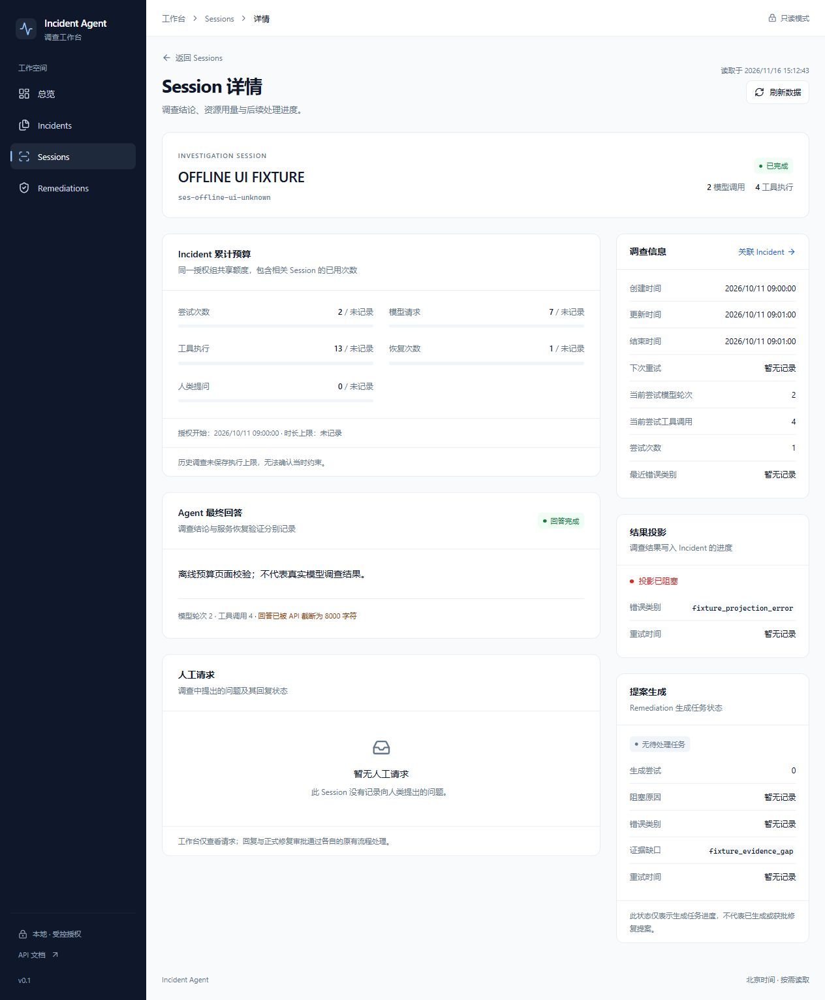

# 第一阶段真实联调问题修复与离线验证

本次完成响应取证入口修正、请求约束和预算展示修复，并完成匹配风险的离线检查。**没有重新进行真实模型联调，不能宣布真实模型调查达到可用标准。** 真实模型请求为 0；没有继续旧 Session，没有重新领取旧实验，没有注入真实故障、执行 Remediation 或进入第二阶段。

## 基线与证据保护

- 工作目录为 `D:\Incident Agent`，分支 main；开始和结束 HEAD 都是 `8e2bc425d304181e9cb95609db58b53e50820a8b`，暂存区为空，未提交、未推送。
- 开始时本地 origin/main 引用与 HEAD 相同。本次未 fetch 或更新远端，不将本地引用当作最新远端查询结果。
- 已阅读当前 AGENTS.md、[真实联调报告](STAGE1_LIVE_MODEL_ACCEPTANCE_2026-11-16_14-01-50.md)、[阶段一验收](STAGE1_ACCEPTANCE_2026-11-15_14-50-13.md) 和 [部署指南](STAGE1_DEPLOYMENT_GUIDE_2026-11-15_12-54-50.md)。历史报告没有改写。
- 对原有 Prompt、temp_test.py、原隔离目录、原 data 和上一轮公开附件建立文件哈希清单，共 **9,191 个文件**；收尾时变更或缺失数为 **0**。没有 reset、clean 或覆盖旧证据。
- 原根目录 `D:\codex use\2026-11-15\stage1-live-20261115-154614` 的 STOP_MODEL、WATCHDOG_DISARM 保留；账本仍是 CLOSED，模型/工具计数仍是 1/1。账本 SHA-256 仍为 `bf5180049f6411427e59a3850f83d40330dc75f13a2b5b4861aeed79a637a2f4`。
- 原有 38 项历史审计警告没有删除、重解释、重新导入或通过补数据消除。旧 Session 的 EXHAUSTED / model_incomplete 和未执行的五个工具调用保持原证据含义。

哈希核对见 [保护结果](assets/stage1-offline-repair-20261116/protected-after.json)。完整初始哈希清单保存在本次 Git 外取证目录。

## 已复现的问题和根因

使用原保存的响应 JSON，分别包装成合成 gzip 和非压缩 HTTP 响应，通过本机实际安装的 openai 3.14.0、httpx2 2.13.0 和生产 ModelClient 进行诊断。没有访问模型服务器，也没有创建 Session 或执行返回的工具。

| 离线路径 | 实际结果 |
| --- | --- |
| 非压缩，返回原响应对象 | completed，5 个 function_call，usage 保留 |
| 非压缩，重建响应对象 | 可解析；不能据此排除压缩场景的缺陷 |
| 合成 gzip，返回原响应对象 | completed，5 个 function_call，usage 保留，底层流关闭 1 次 |
| 合成 gzip，保留编码头并用已解码正文重建 | APIConnectionError，底层 DecodingError；只进入 1 次传输 |

根因是 Git 外 AuditedTransport 在 `read()` 已完成解码后，保留原 content-encoding 头重新构建 Response，导致正文再次解码。修正为读取一次、记录取证内容并返回**同一个 Response 对象**，保留响应头、extensions 和缓存正文的生命周期；读取或验证异常时关闭响应并封闭账本。

原始真实响应没有保存 content-encoding，因此不能断言上一轮线上一定使用了 gzip。APIConnectionError 在该复现中是 SDK 的包装标签，不证明官方连接中断。生产 ModelClient 原先直接返回 SDK 解析结果，**没有发现同样的响应重建代码，也没有向生产 ModelClient 添加这项传输修复**。

复现结果见 [诊断 JSON](assets/stage1-offline-repair-20261116/reproduction.json)。原入口和之前的独立修正版保持不变；本次另存的修正版位于：

- [修正入口](<../../codex use/2026-11-16/stage1-offline-repair/harness/live_worker_repaired.py>)：启动即拒绝执行，在凭据读取、SDK 或 Worker 构造前停止。
- [响应取证传输](<../../codex use/2026-11-16/stage1-offline-repair/harness/audited_transport.py>)、[单次账本守卫](<../../codex use/2026-11-16/stage1-offline-repair/harness/live_gate.py>) 和 [watchdog](<../../codex use/2026-11-16/stage1-offline-repair/harness/watchdog.py>)。

这些文件属于 Git 外隔离入口的修复，不是再次付费执行的授权。

## 必要的仓库改动

| 模块 | 修改及理由 |
| --- | --- |
| [ModelClient](../model_client/model_client.py)、[Agent](../agent/agent.py) | 明确发送 max_output_tokens；默认输出上限 8192、输入上限 65536，可通过 ModelClient 构造参数收紧或配置。增加可信输入上界回调；缺失、计数失败、非整数或超限时在 SDK 请求前阻断。SDK retries 仍是 0。 |
| [Manager](../investigation/manager.py)、[Worker](../investigation/worker.py)、[Checkpoint](../investigation/models.py) | 在现有 Checkpoint 中原子保存 execution_limits。首次实际执行记录执行器配置；已有尝试的恢复如果配置与保存值不一致则拒绝继续，避免展示旧上限却按新上限执行。 |
| [API schema](../web_api/schemas.py)、[查询](../web_api/queries.py) | Session 详情从保存的 execution_limits 返回 limits，新增 limits_source。没有历史记录时 limits=null、source=unrecorded，不用只读 Manager 的生产默认值补齐。 |
| [Session 页面](../frontend/src/pages/SessionDetailPage.tsx)、前端类型及公开契约 | 展示保存上限；未知历史分母和时长显示“未记录”，没有额度进度条，也不将未知显示成 0 或“未开放”。没有硬编码上一轮 1/7/13。 |
| [main](../main.py)、[DemoReplay](../model_client/demo_replay.py)、现有离线验证调用方及测试夹具 | 适配显式输出参数。确定不发送模型请求的回放/Mock 提供零 token 回调；既有单轮和多轮包装器保留自己的更小输出上限。真实模式不获得这种回调。没有新建 Agent、Manager、Worker、Store 或 Provider 实现。 |

现有 Monitor、Manager、Worker、Store、ServiceRegistry、ToolManager、API 和迁移链继续复用；工具权限、告警阈值、全局 3/21/39 预算和审批边界没有调整。没有新增第三方依赖或 Alembic revision：execution_limits 是现有 Checkpoint 文档的可选字段，新代码仍可读取缺少它的旧记录。

输入约束是有意的行为变化：**本次没有取得可验证的同模型输入 token 上界，因此默认真实模式仍会阻断发送**。回调须覆盖 instructions、input、工具 schema 和模型协议开销；不能用字符长度、另一种模型 tokenizer 或上一轮 usage 代替。离线固定回调仅证明阻断与交付逻辑，不证明 DeepSeek 的真实输入计数。

独立隔离 HTTP 入口还会检查最终发送的请求体，拒绝缺失/变化的输出上限、原生付费工具、模型/参数变化和没有输入证明的请求，避免只检查发送前的中间对象。[官方参数说明](https://api-docs.deepseek.com/api/create-response/)确认 max_output_tokens 包含可见输出与推理 token；离线测试检查的也是实际 HTTP JSON 字段。

费用控制与输入 token 控制分开：旧冻结配置不改写；新隔离守卫要求明确的 fee_cap_enabled 配置，关闭费用上限还须有明确豁免标识。启用时按配置的保守输入/输出价格预占，失败或不确定请求保留次数与费用预占。费用豁免不再取消输入上限。费用算术测试使用**合成价格**，没有核实新实时价格、真实费用上界或账单，不能据此启用付费发送。

## 实际验证及结果

Python 使用上一阶段固定依赖环境的 Python 3.12.14；本次临时 MySQL 使用已有 mysql:8.4.13 镜像、专用容器和 ia_test_ 前缀 schema。HTTP 模型传输全部使用内存响应或故障，真实外部网络被测试守卫禁止。真实服务、真实模型、真实历史数据库和原实验 Session 没有参加本轮执行。

| 检查 | 实际结果及边界 |
| --- | --- |
| 核心 HTTP/SDK、隔离守卫和退出组合 | **59 passed**，92.76 秒，退出 0；[日志](assets/stage1-offline-repair-20261116/acceptance-3.log) |
| Runtime/API 首轮相关回归 | 146 passed、2 failed、21 subtests passed，313.55 秒；两项失败来自 Mock 未显式提供零 token 回调，已适配夹具并在下一行复跑通过。没有声称该组整组重新运行通过。 |
| 失败用例复跑、Incident 回归和 DemoReplay | **63 passed、32 subtests passed**，98.85 秒，退出 0；包含上述两项失败用例；[日志](assets/stage1-offline-repair-20261116/compat-1.log) |
| 调用方适配及核心复查 | 22 passed、1 failed；失败是旧预检入口要求 OS 临时目录，本轮 basetemp 放在了 D 盘。保留入口校验，改用全新 OS 临时目录后，失败用例 **1 passed**；[首轮](assets/stage1-offline-repair-20261116/callers-1.log)、[复跑](assets/stage1-offline-repair-20261116/preflight-2.log) |
| 退出与 watchdog 补充 | **7 passed**，29.46 秒，退出 0；[日志](assets/stage1-offline-repair-20261116/exit-2.log)；与组合检查中的 5 项有重叠，不相加冒充独立总数 |
| 前端 | **89 passed**；TypeScript 和生产构建退出 0；[测试](assets/stage1-offline-repair-20261116/frontend-tests-1.log)、[构建](assets/stage1-offline-repair-20261116/frontend-build-1.log) |
| 语法和差异 | 26 个本次相关 Python 文件 AST 解析通过；本次 diff 的空白检查通过。完整 diff 仍有 temp_test.py 原有尾随空白，未触碰该用户修改。 |

没有无依据重复约 30 分钟的后端全量回归。详细轮次、失败与错误数见 [原始验证汇总](assets/stage1-offline-repair-20261116/verification-summary.json)；其中 JUnit 主计数包含 subtest 项，不能直接当作独立主用例数量相加。

交付专项还实际覆盖了：

- 原保存响应的 5 个 call_id、参数和 usage 解析；新建的**离线合成 Session**执行这批离线工具，再取得后续工具选择及最终占位回答，共 3 轮模型响应、7 次工具执行（含自动探针）。支持默认上下文重建 B 路径和仅离线显式启用的完整协议链路径。
- 使用真实 Agent/ToolManager/Worker/Checkpoint 流程；外部证据工具返回标明离线的 no_data，静态依赖/能力读取使用已有 ServiceRegistry。每个配对输出与本轮已提交的记录相符；没有给旧 Session 补造 function_call_output。
- 三轮合成响应的 usage 保留在隔离账本/取证边界；原保存响应仍为 input=10117、output=535、reasoning=279、total=10652。推理数是输出的子集，没有重复计费。没有扩展生产 Runtime 的 usage 持久化数据模型。
- HTTP 401/403/408/429/500、超时、连接、非法 JSON/gzip、不完整或带 error 的响应、空输出、usage 缺失/超限、重复/缺失 call_id、非法工具参数。每个故障只进入 1 次传输，不确定请求仍计数，错误后账本 CLOSED、next_retry_at=null、无自动 resume/reopen 或新 Session，后续 Worker 运行被 model_blocked 阻断。
- 第 8 次模型请求、含探针的第 14 次工具执行、STOP、时限、参数/模型变化、缺少输入证明、费用配置/额度以及账本不可重复领取。
- 独立只读 API 的 Manager 保留默认 3/21/39，但返回执行器保存的非默认 1/5/9 配置；历史缺失配置返回未知，读取不修改 Session/Checkpoint。数值来自测试配置，不是页面常量。

首轮 Windows API 测试的内部 socketpair 被离线网络守卫误拦，已在守卫启用前创建专用事件循环；没有放行任意外部目标。另一轮测试错误地要求默认 B 路径在每一轮都携带所有旧 call_id；代码实际按原设计携带最近的调用/结果身份，较旧观测单独持久化。纠正该测试前提后通过，没有改变生产上下文策略或放宽校验。所有失败轮次原始文件均保留在 Git 外目录。

## 退出、恢复和页面观测

退出演练使用**真实 Python 子进程**运行原控制器代码和修正 watchdog，Docker 命令及业务 HTTP 均为离线模拟：

1. 普通异常进入原 finally：关闭发送通道、恢复模拟故障并 disarm watchdog。
2. `os._exit(97)` 跳过 finally，测试触发独立 watchdog，恢复标志和业务观测均通过。
3. finally 恢复命令失败，watchdog 后续恢复；未把控制器退出当作恢复成功。
4. 模拟 840 秒时限到期触发 watchdog；目标标签不匹配时拒绝操作；命令成功但业务结果无效时拒绝记录 verified。
5. 在原 recovery_only 代码路径上使用已有真实 Store、Monitor、RecoveryWorker/Verifier 和合成 HTTP 业务响应；对 OpenAI、ModelClient、Agent 和调查 Worker 构造函数布置失败哨兵，实际调用数为 0，Session 数和模型计数不变。

这证明的是进程退出控制流与离线恢复判断，**不是实机容器强制退出恢复成功**。watchdog 保留 840 秒时限触发方式；没有宣称其会在控制器退出的瞬间自动检测并恢复。

浏览器实际核对了预算已记录和未记录页面，以及 390 像素窄屏。窄屏页面宽度 375，小于视口 390；采集到的浏览器 error/warn 为 0。页面使用明确标注 OFFLINE UI FIXTURE 的合成 API，实际只读 API 交付已在上面的 MySQL 集成测试中另行验证。不是上一轮真实页面的新截图，也不证明模型结论能力。

[已记录预算页面](assets/stage1-offline-repair-20261116/budget-known-desktop.jpg) · [390 像素页面](assets/stage1-offline-repair-20261116/budget-unknown-390.jpg) · [页面核对 JSON](assets/stage1-offline-repair-20261116/ui-result.json)

## 收尾、限制与后续条件

临时 UI 服务及退出演练子进程已结束，临时 MySQL 容器在核对完整 ID、标签、镜像和无持久卷挂载后删除，本轮容器残留为 0。原有 networklab-exp4-mysql、postgres-exporter、order-db 仍运行；宿主 MySQL80 为 Running。没有删除原实验数据或旧卷。见 [清理结果](assets/stage1-offline-repair-20261116/cleanup-result.json)。离线文件、日志、JUnit、守卫账本和合成夹具保留，不清理旧证据。

Git 外完整取证目录：`D:\codex use\2026-11-16\stage1-offline-repair`。本报告和脱敏附件没有包含真实密钥、认证头、完整模型请求或内部推理正文；测试使用非凭据占位值，没有把原 .env 的真实密钥用于 SDK。

已知影响和未完成验证：

- 真实发送默认被可靠输入证明缺失阻断，包含旧的真实模型验证入口。仅取消费用顾虑不会解除它；本次未提供可用于真实发送的 tokenizer 或完整费用证明。
- API 的 limits 现在可以是 null，新增 limits_source；仓库前端、类型和契约已同步，外部消费方必须处理未知值。新 Checkpoint 的可选字段对新代码读取旧数据兼容，旧版本严格 reader 不保证能读取新增字段，不能混用旧 reader。
- 无自动重试的故障断言针对冻结的隔离入口（1 Attempt、0 resume 和关闭标记）。生产 Runtime 原有可重试策略和默认预算保持，不将本轮结果外推为生产全局禁用重试。
- 未进行新的真实多轮模型、真实工具结果交付、真实结论引用/根因验证、真实账单、真实异常退出容器恢复或生产部署；未跑新的长全量回归与远端 CI。

只有后续获得新的明确授权，先建立可验证的发送前输入/费用约束，再完成真实多轮模型、真实工具结果和结论证据验证，才能重新判断真实调查是否达到可用标准。本次仅交付离线修复结果，原“保持停止”的决定继续有效。
